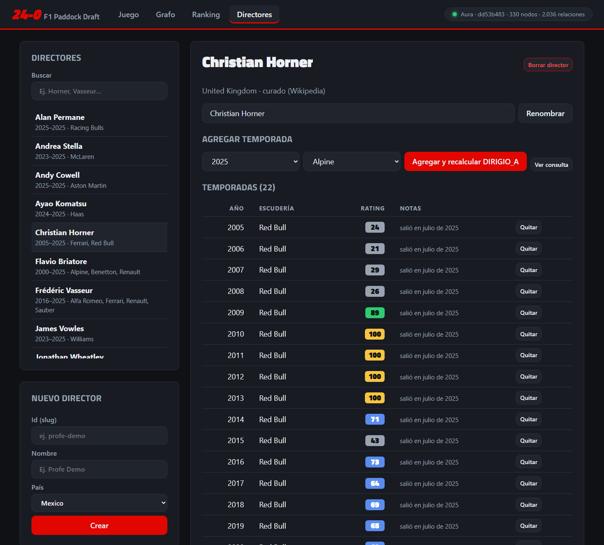
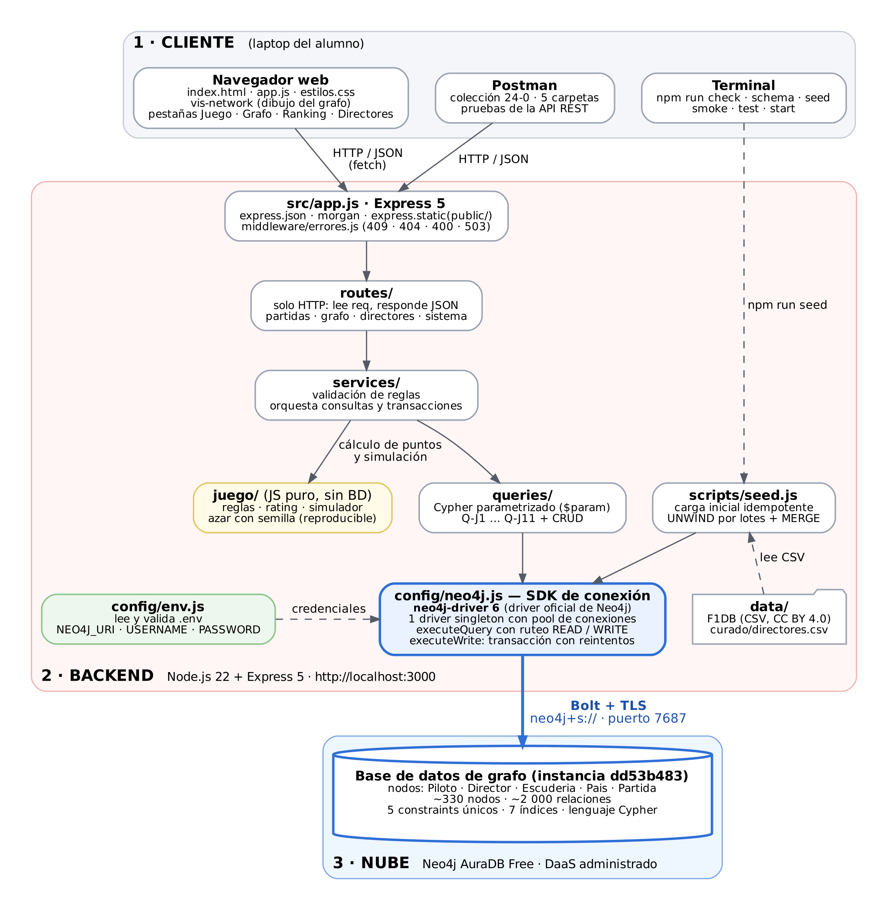
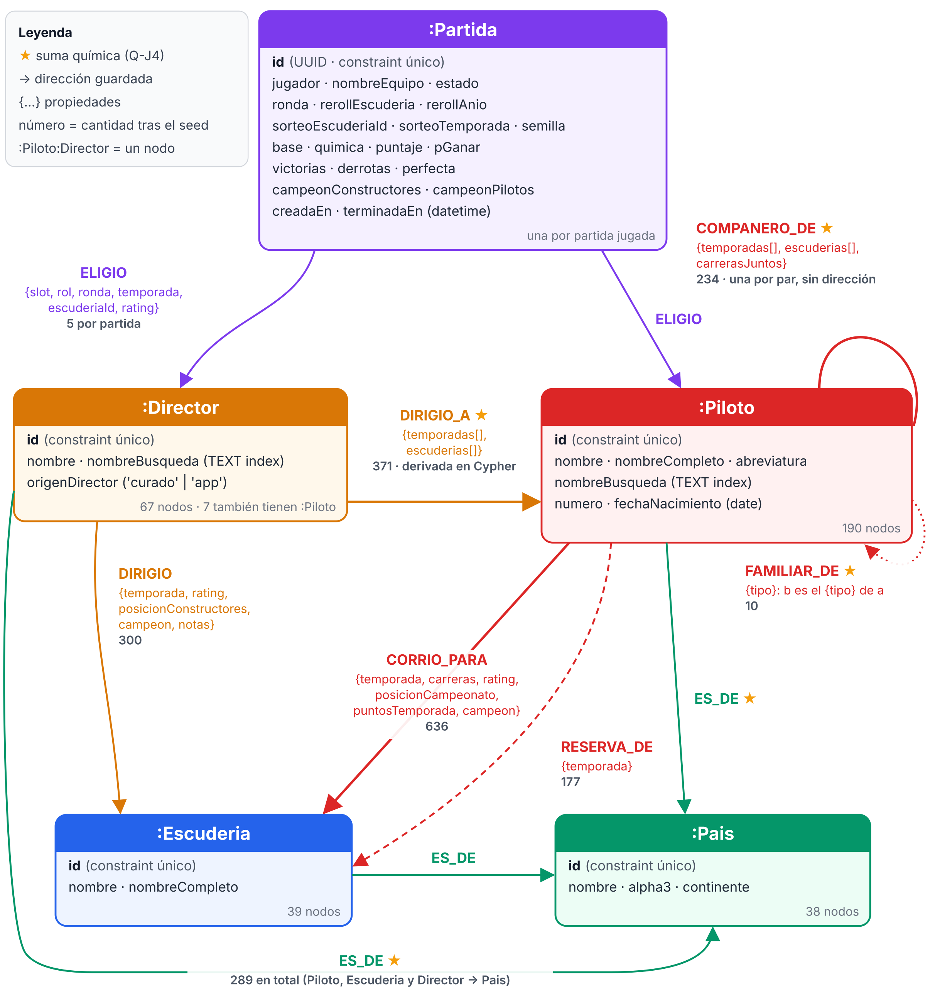

# 24-0 · F1 Paddock Draft

**Un juego de *draft* de Fórmula 1 donde la estrategia sale de una base de datos de grafos.**
Armas un equipo de 5 con pilotos y directores de la F1 de 2000 a 2025, se simula una temporada de 24 carreras y la meta es ganarlas todas: ir **24-0**. Lo que separa a un buen equipo de uno campeón es la **química**: las relaciones entre tus elegidos (compañeros de equipo, director que los dirigió, familia, nacionalidad), que se calculan en **Neo4j AuraDB** con Cypher.


Proyecto final de **Bases de Datos Avanzadas** · Alfredo Vieto · noviembre de 2026.


---

## Contenido

1. [Qué es](#qué-es)
2. [Cómo se juega](#cómo-se-juega)
3. [Por qué una base de datos de grafos](#por-qué-una-base-de-datos-de-grafos)
4. [Arquitectura](#arquitectura)
5. [Modelo de datos](#modelo-de-datos)
6. [Consultas Cypher clave](#consultas-cypher-clave)
7. [Tecnologías](#tecnologías)
8. [Requisitos](#requisitos)
9. [Instalación y configuración](#instalación-y-configuración)
10. [Uso](#uso)
11. [API REST](#api-rest)
12. [Pruebas](#pruebas)
13. [Estructura del repositorio](#estructura-del-repositorio)
14. [Decisiones de diseño](#decisiones-de-diseño)
15. [Solución de problemas](#solución-de-problemas)
16. [Limitaciones y trabajo futuro](#limitaciones-y-trabajo-futuro)
17. [Créditos, datos y licencias](#créditos-datos-y-licencias)

---

## Qué es

*24-0* toma la idea de juegos como *17-0* (NFL) u *82-0* (NBA) y la lleva a la Fórmula 1:

- En cada ronda sale al azar una **escudería y un año** (por ejemplo, *Williams 2003*).
- Eliges a un **piloto**, a un **piloto de reserva** o al **director de equipo** de esa escudería en esa temporada.
- Con 5 elecciones completas tu equipo y se **simula una temporada de 24 carreras**.
- Ganas el campeonato de constructores con 12 victorias o más, el de pilotos si uno de tus titulares gana 9 o más, y el máximo logro es la **temporada perfecta: 24-0**.

La aplicación tiene cuatro pestañas:

| Pestaña | Para qué sirve |
|---|---|
| **Juego** | El draft completo: sorteo, elección, química en vivo, simulación y resultado. No pide registro. |
| **Grafo** | Elige pilotos y un rango de años y ve cómo se conectan por escuderías, compañeros, directores, familia y país. |
| **Ranking** | Las mejores temporadas jugadas, identificadas por sus 5 elegidos. |
| **Directores** | CRUD de directores de equipo. Al agregarle una temporada a un director, la relación `DIRIGIO_A` se recalcula en Cypher. |

| Draft | Pestaña Grafo | Directores |
|---|---|---|
|  |  |  |

---

## Cómo se juega

1. **Jugar.** Un clic, sin registro.
2. **Girar.** Dos rodillos sortean escudería y año (2000–2025). Solo el primer giro es manual: después de cada elección el siguiente arranca solo.
3. **Elegir.** Cada candidato muestra su **rating** de esa temporada y una pista de química ("⚡ Conecta con Hamilton"). Lo asignas a un puesto libre compatible.
4. **Re-rolls.** Tienes **1 re-roll de escudería** (mismo año, otro equipo) y **1 de año** (mismo equipo, otro año). Si no hay alternativa (por ejemplo, *Brawn* solo existe en 2009), el re-roll no se gasta. Si nadie del sorteo cabe en tus puestos libres, el giro siguiente es gratis y automático.
5. **Simular.** Con los 5 puestos llenos se calcula el puntaje y se juegan las 24 carreras.

### Puestos

| Puesto | Acepta | Peso en el puntaje base |
|---|---|---|
| Director | Director | 0.30 |
| Piloto 1 | Piloto | 0.25 |
| Piloto 2 | Piloto | 0.25 |
| Flex | Piloto **o** Director | 0.15 |
| Reserva | Piloto | 0.05 |

### Rating por temporada (0–100)

Se calcula con la clasificación final de cada año, así que un campeón del 2000 vale lo mismo que uno de 2024 aunque el sistema de puntos haya cambiado:

```
rating = round(100 × (0.6 × puntos / puntosDelCampeón + 0.4 × (1 − (posición − 1) / (N − 1))))
```

- **Piloto:** su resultado en el campeonato de pilotos de ese año. Por ejemplo, Verstappen 2023 = 100 y Pérez 2023 = 68.
- **Director:** el resultado de su escudería en el campeonato de constructores. Por ejemplo, Horner con Red Bull en 2023 = 100.
- **Reserva que no corrió ese año:** 30. **Piloto sin clasificación o equipo excluido** (McLaren 2007): 20.

### Química (la parte de grafos)

Se revisan los **10 pares** posibles entre tus 5 elegidos:

| Conexión en el grafo | Puntos |
|---|---|
| Fueron compañeros de equipo (`COMPANERO_DE`) | +3 |
| El director dirigió al piloto (`DIRIGIO_A`) | +3 |
| Son familia (`FAMILIAR_DE`) | +4 |
| Misma nacionalidad (`ES_DE` en común) | +1 |
| Sin conexión directa, pero con un conocido en común (camino de 2 saltos) | +1 |
| **Tope total** | **+15** |

### Puntaje y simulación

```
base     = Σ (peso del puesto × rating)                     // 0–100
puntaje  = base + min(química, 15)                          // 0–115
pGanar   = clamp(1 / (1 + e^(−(puntaje − 74) / 5)), 0.01, 0.96)
```

Cada carrera es una tirada con `pGanar`. El generador aleatorio usa una **semilla** derivada del id de la partida, así que la misma partida siempre produce el mismo resultado. Las victorias se reparten entre los 2 titulares en proporción a su rating.

| Puntaje | Probabilidad por carrera | Victorias esperadas |
|---|---|---|
| 60 | 6 % | 1.4 |
| 70 | 31 % | 7.4 |
| 74 | 50 % | 12.0 |
| 80 | 77 % | 18.4 |
| 85 | 90 % | 21.6 |
| 90+ | 96 % | 23.0 |

La curva se calibró con 20 000 drafts simulados con los datos reales: un jugador que siempre toma al mejor disponible gana el campeonato de constructores en ~23 % de las partidas y logra el 24-0 en ~3 %. Ganar es posible; la temporada perfecta tiene que costar.

---

## Por qué una base de datos de grafos

La mecánica central del juego es una pregunta de **relaciones**: *¿cómo están conectadas estas 5 personas?* Ese es el caso de uso natural de un grafo.

**En SQL**, calcular la química exigiría, para cada uno de los 10 pares:
- un JOIN contra una tabla de compañeros (o un self-JOIN sobre resultados por carrera y escudería),
- un JOIN de cuatro tablas director → temporada → escudería → piloto,
- un JOIN contra la tabla de parentescos y otro contra nacionalidades,
- una **CTE recursiva** para encontrar a los "conocidos en común" a 2 saltos.

Su costo crece con el tamaño de las tablas, no con el de la respuesta.

**En Cypher**, es un solo patrón sobre el **subgrafo inducido** por los 5 elegidos (ver [Q-J4](#q-j4--química-subgrafo-inducido--shortestpath)). Neo4j sigue punteros directos entre nodos (*index-free adjacency*), así que el costo depende de los vecinos que se visitan y no del tamaño total de la base.

Además, el proyecto usa cosas propias de un **grafo de propiedades**:

| Característica | Dónde se usa |
|---|---|
| **Multi-label** | 7 personas fueron pilotos y luego directores (Prost, Lauda, Albers, Aguri Suzuki…). Son **un solo nodo** `:Piloto:Director`. En SQL habría que duplicar la fila o crear una tabla de roles. |
| **Propiedades en las relaciones** | El rating depende de la temporada, así que vive en `CORRIO_PARA` y `DIRIGIO`, no en el nodo. |
| **Relaciones derivadas** | `COMPANERO_DE` se materializa en el seed desde los resultados de carrera. `DIRIGIO_A` se deriva **con un patrón Cypher** (Q-J9) y se recalcula en la misma transacción cuando cambia un director. |
| **Esquema flexible** | Agregar `Director`, `Partida` y sus relaciones no requirió migrar nada de lo existente. |
| **Búsqueda de caminos** | `shortestPath` para la cercanía a 2 saltos. |
| **Aleatoriedad en la base** | El sorteo usa `ORDER BY rand()` sobre las escuderías-temporada válidas. |

---

## Arquitectura



| Capa | Responsabilidad |
|---|---|
| **Cliente** | Web en HTML + JS vanilla con vis-network para dibujar grafos; Postman y la terminal para pruebas. |
| `routes/` | Solo HTTP: lee la petición y responde JSON. |
| `services/` | Validación, reglas del juego y **transacciones**. |
| `queries/` | Todo el Cypher, siempre con parámetros `$param`. |
| `juego/` | Motor puro en JavaScript (sin base de datos): reglas, rating, química → puntos, simulación con semilla. |
| `config/neo4j.js` | Un solo `driver` por proceso (pool de conexiones), lecturas con ruteo `READ` y escrituras con `WRITE`. |
| **Neo4j AuraDB Free** | Base de datos de grafos administrada en la nube (DaaS), conexión cifrada `neo4j+s://` (Bolt + TLS). |

---

## Modelo de datos



### Nodos

| Label | Propiedades principales | Cantidad |
|---|---|---|
| `Piloto` | id, nombre, nombreBusqueda, nombreCompleto, abreviatura, numero, fechaNacimiento | 190 |
| `Director` | id, nombre, nombreBusqueda, origenDirector (`curado` / `app`) | 67 (7 también son `Piloto`) |
| `Escuderia` | id, nombre, nombreCompleto | 39 |
| `Pais` | id, nombre, alpha3, continente | 38 |
| `Partida` | id (UUID), estado, ronda, re-rolls, sorteo actual, semilla, base, química, puntaje, victorias, derrotas, campeonatos, fechas | una por partida jugada |

**Total tras el seed:** 327 nodos y 2 017 relaciones.

### Relaciones

| Tipo | Dirección | Propiedades | Cantidad |
|---|---|---|---|
| `CORRIO_PARA` | Piloto → Escuderia | temporada, carreras, rating, posicionCampeonato, puntosTemporada, campeon | 636 |
| `DIRIGIO_A` | Director → Piloto | temporadas[], escuderias[] (**derivada en Cypher**) | 371 |
| `DIRIGIO` | Director → Escuderia | temporada, rating, posicionConstructores, campeon, notas | 300 |
| `ES_DE` | Piloto · Escuderia · Director → Pais | — | 289 |
| `COMPANERO_DE` | Piloto — Piloto (una por par) | temporadas[], escuderias[], carrerasJuntos | 234 |
| `RESERVA_DE` | Piloto → Escuderia | temporada | 177 |
| `FAMILIAR_DE` | Piloto → Piloto | tipo | 10 |
| `ELIGIO` | Partida → Piloto \| Director | slot, rol, ronda, temporada, escuderiaId, rating (foto del momento) | 5 por partida |

### Constraints e índices ([`scripts/schema.cypher`](scripts/schema.cypher))

- **5 constraints de unicidad** sobre `id` (Piloto, Escuderia, Pais, Director, Partida). Cada una crea su índice, así que cada traversal arranca por índice.
- **2 índices TEXT** sobre `nombreBusqueda` (Piloto, Director) para buscar sin acentos con `CONTAINS`.
- **2 índices de rango** en `Partida` (`estado`, `puntaje`) para el ranking.
- **3 índices de relación** sobre `temporada` (`CORRIO_PARA`, `DIRIGIO`, `RESERVA_DE`) porque el sorteo y los candidatos filtran por año.

---

## Consultas Cypher clave

El catálogo completo (Q-J1 a Q-J11) está en [`docs/juego-24-0.md`](docs/juego-24-0.md) §4 y en [`src/queries/`](src/queries/). Estas son las más representativas.

### Q-J1 · Sorteo (la aleatoriedad la pone la base)

```cypher
MATCH (e:Escuderia)<-[cp:CORRIO_PARA]-(:Piloto)
WHERE $anioMin <= cp.temporada <= $anioMax
  AND ($escuderiaFija IS NULL OR e.id = $escuderiaFija)        // re-roll de año
  AND ($temporadaFija IS NULL OR cp.temporada = $temporadaFija) // re-roll de escudería
  AND ($excluirEscuderia IS NULL OR e.id <> $excluirEscuderia)
  AND ($excluirTemporada IS NULL OR cp.temporada <> $excluirTemporada)
WITH DISTINCT e, cp.temporada AS temporada
WHERE NOT $requiereDirector OR EXISTS { (:Director)-[:DIRIGIO {temporada: temporada}]->(e) }
RETURN e.id AS escuderiaId, e.nombre AS escuderia, temporada
ORDER BY rand() LIMIT 1
```

### Q-J4 · Química (subgrafo inducido + shortestPath)

```cypher
MATCH (pa:Partida {id: $partidaId})-[el:ELIGIO]->(x)
WITH collect({nodo: x, slot: el.slot}) AS equipo
UNWIND equipo AS ea
UNWIND equipo AS eb
WITH ea.nodo AS a, eb.nodo AS b WHERE elementId(a) < elementId(b)        // los 10 pares
OPTIONAL MATCH (a)-[r:COMPANERO_DE|DIRIGIO_A|FAMILIAR_DE]-(b)            // conexiones directas
WITH a, b, [c IN collect({tipo: type(r), temporadas: r.temporadas}) WHERE c.tipo IS NOT NULL] AS directas
OPTIONAL MATCH (a)-[:ES_DE]->(pais:Pais)<-[:ES_DE]-(b)                    // misma nacionalidad
CALL (a, b) {
  OPTIONAL MATCH camino = shortestPath((a)-[:COMPANERO_DE|DIRIGIO_A*..2]-(b))
  RETURN length(camino) AS saltos                                          // conocido en común
}
RETURN a.id, b.id, directas, pais.nombre AS paisComun, saltos
```

El Cypher solo **encuentra** las relaciones. Cuánto vale cada una lo decide [`src/juego/reglas.js`](src/juego/reglas.js), así que los puntos se pueden ajustar sin tocar las consultas.

### Q-J9 · Derivar `DIRIGIO_A` con un patrón del grafo

```cypher
MATCH (d:Director)-[di:DIRIGIO]->(e:Escuderia)<-[cp:CORRIO_PARA]-(p:Piloto)
WHERE cp.temporada = di.temporada AND d <> p AND ($id IS NULL OR d.id = $id)
WITH d, p, collect(DISTINCT di.temporada) AS temporadas, collect(DISTINCT e.id) AS escuderias
MERGE (d)-[r:DIRIGIO_A]->(p)
SET r.temporadas = temporadas, r.escuderias = escuderias
```

En la web, el botón **"Ver consulta"** muestra el Cypher que se acaba de ejecutar en Aura (química, grafo y directores) junto con el tiempo que tardó.

---

## Tecnologías

| Componente | Tecnología | Uso |
|---|---|---|
| Base de datos | **Neo4j AuraDB Free** (DaaS) + Cypher | Grafo en la nube |
| Driver | `neo4j-driver` 6 (oficial) | Conexión Bolt + TLS, transacciones administradas |
| Backend | Node.js 22/24 (ES Modules) + **Express 5** | API REST y archivos estáticos |
| Utilidades | `dotenv`, `csv-parse`, `morgan` | Variables de entorno, lectura de CSV y log HTTP |
| Front-end | HTML + CSS + JavaScript vanilla, [vis-network](https://visjs.github.io/vis-network/) 9.1.9 (CDN), Titillium Web (Google Fonts) | Juego, dibujo de grafos y animaciones |
| Pruebas | `node:test`, script de smoke, colección de Postman / Newman | Motor, API completa y flujo de juego |

Sin frameworks de front ni bundlers. Sin dependencias extra: los UUID salen de `crypto.randomUUID()` y el generador aleatorio con semilla (`mulberry32`) es código propio.

---

## Requisitos

| Requisito | Versión | Verificar |
|---|---|---|
| Node.js (incluye npm) | 22.x o 24.x LTS | `node -v` |
| Git | 2.40+ | `git --version` |
| Instancia de **Neo4j AuraDB Free** | — | [console.neo4j.io](https://console.neo4j.io) |
| Navegador moderno | Chrome, Edge o Firefox | — |
| Postman (opcional) | última | para correr la colección |

**Red:** el driver se conecta a Aura por el **puerto 7687** (Bolt sobre TLS). Algunas redes institucionales lo bloquean.

**Límites de AuraDB Free:** hasta 200 000 nodos y 400 000 relaciones (el proyecto usa ~330 y ~2 000). La instancia **se pausa sola tras 3 días sin actividad** y se reanuda desde la consola sin perder datos.

---

## Instalación y configuración

```powershell
# 1. Clonar e instalar dependencias
git clone https://github.com/alfredovieto/proyecto_basededatos.git
cd proyecto_basededatos
npm install

# 2. Configurar credenciales de Aura
Copy-Item .env.example .env          # en macOS/Linux: cp .env.example .env
#    edita .env con los datos de tu instancia (ver tabla)

# 3. Probar la conexión
npm run check

# 4. Cargar los datos (schema + F1DB 2000–2025 + directores; ~15 s, idempotente)
npm run seed

# 5. Levantar la aplicación
npm start                            # http://localhost:3000
```

### Variables de entorno (`.env`)

| Variable | Descripción | Ejemplo |
|---|---|---|
| `NEO4J_URI` | URI de la instancia; **debe** empezar con `neo4j+s://` | `neo4j+s://xxxxxxxx.databases.neo4j.io` |
| `NEO4J_USERNAME` | Usuario de Aura | `neo4j` |
| `NEO4J_PASSWORD` | Contraseña de Aura | *(secreta)* |
| `NEO4J_DATABASE` | Nombre de la base | `neo4j` |
| `PORT` | Puerto de la web (opcional) | `3000` |

`.env` está en `.gitignore`: las credenciales nunca se suben al repositorio. La app solo las lee desde [`src/config/env.js`](src/config/env.js) y se detiene con un mensaje claro si falta alguna.

---

## Uso

### Scripts npm

| Comando | Qué hace |
|---|---|
| `npm start` | Levanta la API y la web en `http://localhost:3000` |
| `npm run dev` | Igual, pero reinicia al guardar (`node --watch`) |
| `npm run check` | Conexión a Aura: host, versión, latencia, nodos y relaciones |
| `npm run schema` | Crea constraints e índices; se puede repetir |
| `npm run seed` | Seed completo e idempotente: schema, F1DB filtrado a 2000–2025, ratings, reservas, directores y `DIRIGIO_A` |
| `npm run validar-directores` | Revisa `data/curado/directores.csv`: cobertura 275/275 escuderías-temporada, ids válidos y sin duplicados |
| `npm run limpiar-demo` | Borra las partidas y lo creado desde la pestaña Directores; deja la base como recién sembrada |
| `npm run reset -- --si` | Vacía la base completa (no toca el schema) |
| `npm test` | Pruebas unitarias del motor del juego |
| `npm run smoke` | Prueba de punta a punta contra la API levantada |

### URLs útiles

| URL | Abre |
|---|---|
| `http://localhost:3000/` | El juego |
| `/?partida=<id>#juego` | Retoma (o muestra el resultado de) una partida |
| `/?pilotos=max-verstappen,jos-verstappen&desde=2000&hasta=2025#grafo` | El grafo ya cargado con esos pilotos |
| `/?director=christian-horner#directores` | La ficha de un director |

La partida en curso se guarda en `localStorage`, así que recargar la página no la pierde. Desde la consola del navegador, `window.juego` muestra el estado completo.

**Accesibilidad:** `Enter` gira, las teclas `1`–`5` eligen el puesto de la tarjeta enfocada, el foco es visible y, si el sistema pide menos movimiento (`prefers-reduced-motion`), las animaciones se desactivan.

---

## API REST

Todas las rutas viven bajo `/api` y responden JSON. Los errores tienen siempre el mismo formato:

```json
{ "error": { "codigo": "SORTEO_PENDIENTE", "mensaje": "Ya hay un sorteo pendiente: elige un candidato o usa un re-roll." } }
```

| Código HTTP | Códigos de error |
|---|---|
| 400 | `VALIDACION` |
| 404 | `NO_ENCONTRADO`, `RUTA_NO_ENCONTRADA` |
| 409 | `SORTEO_PENDIENTE`, `SIN_SORTEO`, `SIN_REROLLS`, `SIN_OPCIONES`, `PUESTO_OCUPADO`, `YA_ELEGIDO`, `NO_ES_CANDIDATO`, `EQUIPO_COMPLETO`, `EQUIPO_INCOMPLETO`, `PARTIDA_TERMINADA`, `DUPLICADO`, `SIN_TEMPORADA`, `EN_USO` |
| 503 | `BD_NO_DISPONIBLE` (sin conexión con Aura) |

### Partidas

| Método | Ruta | Descripción |
|---|---|---|
| POST | `/api/partidas` | Crea una partida (sin body; `jugador` y `nombreEquipo` son opcionales) |
| GET | `/api/partidas?estado=terminada&limite=10` | Ranking, cada partida con sus 5 `elegidos` |
| GET · PATCH · DELETE | `/api/partidas/:id` | Leer (elecciones, puestos libres y sorteo) · renombrar · borrar |
| POST | `/api/partidas/:id/sorteo` | Girar: `{ "reroll": null \| "escuderia" \| "anio" }` |
| GET | `/api/partidas/:id/candidatos` | Candidatos del sorteo con rating, pista de química y puestos compatibles |
| POST | `/api/partidas/:id/elecciones` | Elegir `{ personaId, rol, slot }`: validación y creación en **una transacción** |
| GET | `/api/partidas/:id/quimica` | Química del equipo, lista para vis-network, más la consulta ejecutada |
| POST | `/api/partidas/:id/simular` | Simula las 24 carreras (reproducible) y guarda el resultado |

### Grafo y directores

| Método | Ruta | Descripción |
|---|---|---|
| GET | `/api/health` | Estado de la conexión con Aura |
| GET | `/api/pilotos?buscar=&desde=&hasta=` | Autocompletar pilotos que corrieron en el rango (sin acentos) |
| GET | `/api/grafo?pilotos=a,b&desde=&hasta=&incluir=` | Subgrafo de hasta 40 pilotos en un rango de años |
| GET | `/api/directores?buscar=` | Listar o buscar directores |
| POST | `/api/directores` | Crear `{ id, nombre, paisId }` |
| GET · PATCH · DELETE | `/api/directores/:id` | Ficha (temporadas y pilotos dirigidos) · renombrar · borrar (409 `EN_USO` si fue elegido en partidas) |
| POST | `/api/directores/:id/temporadas` | `{ escuderiaId, temporada }` → crea `DIRIGIO` y recalcula `DIRIGIO_A` en una transacción |
| DELETE | `/api/directores/:id/temporadas/:escuderiaId/:temporada` | Quita la temporada y recalcula |
| GET | `/api/paises` · `/api/escuderias?temporada=` | Catálogos para formularios |

### Ejemplo: una ronda

```http
POST /api/partidas/{id}/sorteo
Content-Type: application/json

{ "reroll": null }
```

```json
{ "escuderiaId": "ferrari", "escuderia": "Ferrari", "temporada": 2007,
  "rerolls": { "escuderia": 1, "anio": 1 } }
```

```http
POST /api/partidas/{id}/elecciones
Content-Type: application/json

{ "personaId": "kimi-raikkonen", "rol": "PILOTO", "slot": "PILOTO_1" }
```

```json
{ "eleccion": { "slot": "PILOTO_1", "rol": "PILOTO", "id": "kimi-raikkonen", "nombre": "Kimi Räikkönen",
                "temporada": 2007, "escuderiaId": "ferrari", "rating": 100, "ronda": 1 },
  "siguienteRonda": 2,
  "quimica": { "nodos": [ … ], "aristas": [], "total": 0, "totalConTope": 0, "consulta": { … } } }
```

El rating se toma **de la base**, nunca del cliente.

---

## Pruebas

| Prueba | Comando | Qué cubre |
|---|---|---|
| Unitarias | `npm test` | Fórmula de rating (campeón = 100, Pérez 2023 = 68, equipos excluidos), química (cada tipo cuenta una vez por par, cercanía solo sin conexión directa, tope de 15), probabilidad con piso y techo, titulares, simulación reproducible por semilla y suma de victorias. 12 pruebas con `node:test`. |
| Smoke | `npm run smoke` (con la API levantada) | Partida completa sin registro, errores 400/404/409, simulación repetida con el mismo récord, ranking, pestaña Grafo (Alonso y Hamilton compañeros en 2007) y CRUD de directores (Ferrari 2024 → Leclerc, Sainz y Bearman). |
| Postman | Importa [`postman/24-0.postman_collection.json`](postman/24-0.postman_collection.json) y córrela con el Collection Runner, o `npx newman run postman/24-0.postman_collection.json` | 57 requests y 120 aserciones: un flujo que juega una partida completa solo, reglas y re-rolls (incluido `SIN_REROLLS`), grafo y directores. |
| Datos | `npm run validar-directores` | `directores.csv` cubre las 275 escuderías-temporada 2000–2025 y todos sus ids existen en F1DB. |

---

## Estructura del repositorio

```
├── data/
│   ├── f1db/                  # CSV de F1DB (CC BY 4.0) que usa el seed + README de los datos
│   └── curado/directores.csv  # directores de equipo 2000–2025 (Wikipedia, CC BY-SA)
├── docs/
│   ├── juego-24-0.md          # documento del proyecto: reglas, modelo, catálogo Cypher, decisiones y fases
│   ├── capturas/              # capturas de la web
│   └── entrega/               # PDF de entrega y diagramas (arquitectura y modelo)
├── postman/                   # colección de pruebas de la API
├── public/                    # web: index.html, app.js, estilos.css
├── scripts/
│   ├── seed.js                # carga inicial por lotes (UNWIND + MERGE), idempotente
│   ├── schema.cypher          # constraints e índices
│   ├── validar-directores.js  # valida el CSV curado
│   ├── smoke.js               # prueba de punta a punta de la API
│   ├── check.js · schema.js · reset.js · limpiar-demo.js
│   └── lib/                   # lectura de CSV y aplicación del schema
├── src/
│   ├── config/                # env.js (lee .env) y neo4j.js (driver singleton y transacciones)
│   ├── juego/                 # motor puro: reglas, rating, simulador, azar con semilla
│   ├── queries/               # todo el Cypher (juego, grafo, directores, seed)
│   ├── services/              # validación, reglas y transacciones
│   ├── routes/                # routers de Express (solo HTTP)
│   ├── middleware/            # formato de error uniforme
│   ├── utils/                 # validación, texto y conversión de tipos de Neo4j
│   ├── app.js                 # configuración de Express
│   └── server.js              # punto de entrada (verifica Aura antes de escuchar)
├── test/                      # pruebas con node:test
├── .env.example               # plantilla de credenciales
└── package.json
```

---

## Decisiones de diseño

1. **El rating vive en la relación, no en el nodo.** Un piloto tiene un rating distinto cada año, y la temporada es una propiedad de `CORRIO_PARA` / `DIRIGIO`.
2. **`ELIGIO` guarda una foto** (rating, temporada, escudería) del momento de la elección. Si después se corrige un dato, las partidas terminadas no cambian.
3. **Elegir es una sola transacción.** Se valida que la persona sea candidata del sorteo actual, que el puesto esté libre y que no esté repetida, y se crea la elección. La consulta además protege con `NOT EXISTS` contra un doble clic.
4. **Dos formas de materializar relaciones.** `COMPANERO_DE` se calcula en Node durante el seed (desde 10 562 resultados de carrera). `DIRIGIO_A` se calcula con un patrón Cypher y se recalcula en la misma transacción cuando se edita un director.
5. **La lógica del juego vive en JavaScript; el grafo resuelve las relaciones.** El motor (`src/juego/`) es puro y se prueba sin base de datos. Las reglas (pesos, puntos, curva) están en un solo archivo.
6. **Aleatoriedad repartida.** El sorteo lo hace la base (`rand()`); el resultado lo hace el servidor con semilla, para que sea reproducible.
7. **Siempre parámetros `$param`** y enteros enviados con `neo4j.int()` (los `number` de JS viajan como Float). El driver se crea con `disableLosslessIntegers: true`.
8. **Solo 2000–2025.** 2026 sigue en curso. Ampliar el rango es cambiar `ANIO_MIN` / `ANIO_MAX` en `reglas.js` y volver a sembrar.

---

## Solución de problemas

| Síntoma | Causa probable | Solución |
|---|---|---|
| `ServiceUnavailable` / `Could not perform discovery` / `No routing servers available` | Aura pausada, URI mal escrita, puerto 7687 bloqueado o falla momentánea de red | Reanuda la instancia en console.neo4j.io, revisa `neo4j+s://` en `.env`, reintenta `npm run check` o cambia de red (por ejemplo, al hotspot del celular) |
| `Neo.ClientError.Security.Unauthorized` | Usuario o contraseña incorrectos | Vuelve a copiar las credenciales de Aura en `.env` |
| `Faltan variables de entorno` al arrancar | No existe `.env` o le falta una variable | Copia `.env.example` a `.env` y llénalo |
| `EADDRINUSE :::3000` | Otro proceso usa el puerto 3000 | Ciérralo o cambia `PORT` en `.env` |
| El servidor se reinicia solo con `npm run dev` | Herramientas de sincronización (por ejemplo, OneDrive) tocan archivos y `node --watch` los detecta | Usa `npm start` |
| `npm.ps1 cannot be loaded` en Windows | Política de ejecución de PowerShell | `Set-ExecutionPolicy -Scope CurrentUser RemoteSigned` |
| `EPERM` / `EBUSY` en `npm install` | Sincronización de la carpeta `node_modules` | Pausa la sincronización mientras instalas y reintenta |
| Respuestas lentas (1–3 s) | Latencia con la región de Aura | Es normal en el plan gratuito; las animaciones de la web cubren la espera |

---

## Limitaciones y trabajo futuro

- **Datos curados.** Los directores (`directores.csv`) se armaron a partir de Wikipedia y prensa especializada. Las 13 filas marcadas con `confianza = media` son cargos poco claros (interinos, *deputy*, CEO). Se pueden corregir desde la pestaña Directores.
- **Cambios de equipo a mitad de año.** F1DB tiene una sola fila por piloto y año en el campeonato, así que un piloto que cambió de equipo (Lawson 2025) tiene el mismo rating en ambos.
- **Sin cuentas de usuario.** El juego no pide registro; el ranking es global y se identifica por los elegidos.
- **Ideas:** multijugador con el mismo sorteo, modo diario con semilla compartida, ampliar a temporadas anteriores a 2000 y desafíos ("gana con un equipo sin campeones del mundo").

---

## Créditos, datos y licencias

- **Datos de Fórmula 1:** [F1DB](https://github.com/f1db/f1db), licencia [CC BY 4.0](https://creativecommons.org/licenses/by/4.0/). Detalle de archivos en [`data/f1db/README.md`](data/f1db/README.md).
- **Directores de equipo:** Wikipedia y prensa especializada, licencia [CC BY-SA 4.0](https://creativecommons.org/licenses/by-sa/4.0/).
- **Visualización:** [vis-network](https://github.com/visjs/vis-network) (Apache 2.0 / MIT). **Tipografía:** Titillium Web (SIL Open Font License).
- **Código:** proyecto académico sin licencia pública (`UNLICENSED`).
- Proyecto escolar **sin relación con la Fórmula 1, la FIA ni ningún equipo**. No usa logos ni marcas, solo nombres en texto.

**Autor:** Alfredo Vieto · Bases de Datos Avanzadas · 2026.
