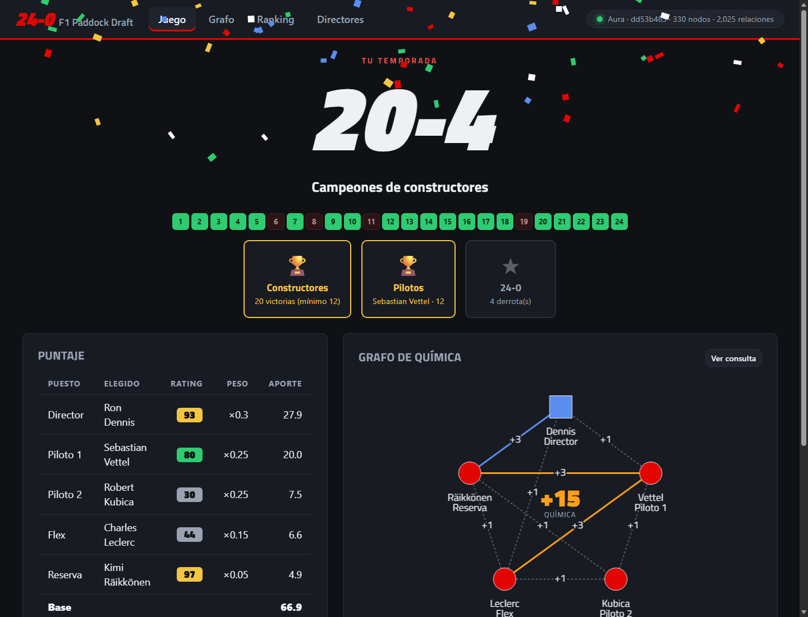
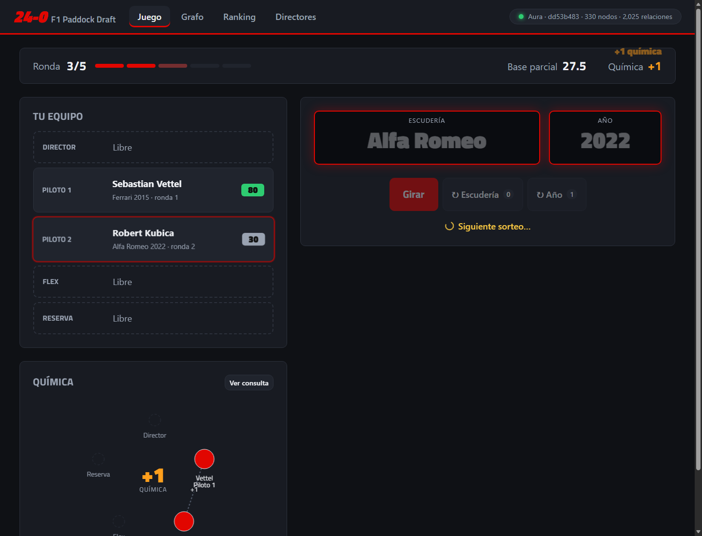
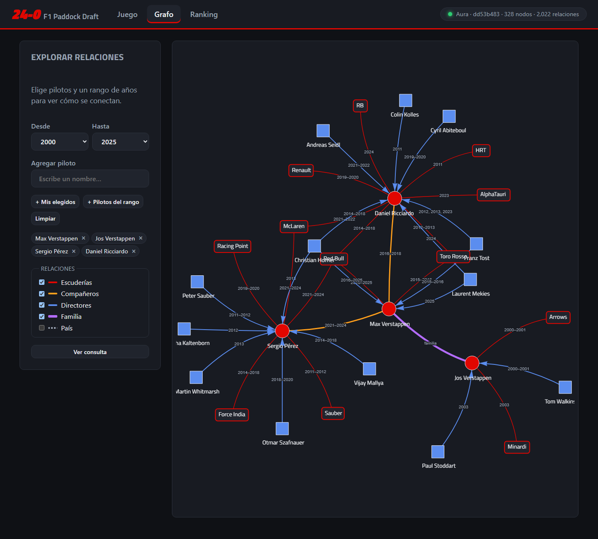
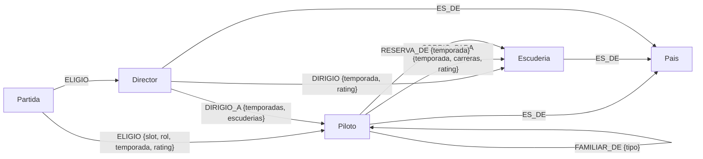

# 24-0 · F1 Paddock Draft

Juego web de *draft* de Fórmula 1 (temporadas **2000–2025**) cuya mecánica central sale de un **grafo** en **Neo4j AuraDB Free** (en la nube). Cada ronda sale al azar una escudería y un año; eliges a un piloto o al director de ese equipo, armas un equipo de 5 y se simula una temporada de 24 carreras. La meta: ir **24-0**.

El puntaje depende de la **química**: las relaciones del grafo entre tus 5 elegidos (compañeros de equipo, director que dirigió a un piloto, familia, misma nacionalidad, conocidos en común). Además, la pestaña **Grafo** permite elegir pilotos y un rango de años para ver cómo se relacionan, y la pestaña **Directores** es el CRUD de directores de equipo (al agregarle una temporada, `DIRIGIO_A` se recalcula en Cypher).

Proyecto final de **Bases de Datos Avanzadas** · Alfredo Vieto.



| Draft | Pestaña Grafo |
|---|---|
|  |  |

---

## Cómo se juega

1. **Jugar** (sin registro).
2. **Girar**: sale una escudería + año (ej. *Williams 2003*). Solo el primer giro es manual; después de cada elección el siguiente giro arranca solo. Tienes 1 re-roll de escudería (mismo año) y 1 de año (misma escudería).
3. Elige un candidato (piloto, reserva o director de ese equipo y año) para un puesto libre: **Director**, **Piloto 1**, **Piloto 2**, **Flex** (piloto o director) o **Reserva**. Cada tarjeta dice con quién de tu equipo conecta.
4. Tras 5 rondas, **Simular temporada**: `puntaje = base (ratings ponderados) + química (máx. +15)` → probabilidad de ganar cada carrera → récord, campeonato de constructores (≥ 12 victorias) y de pilotos (≥ 9 de un titular).

| Química (por par de elegidos) | Puntos |
|---|---|
| Compañeros de equipo (`COMPANERO_DE`) | +3 |
| El director lo dirigió (`DIRIGIO_A`) | +3 |
| Familia (`FAMILIAR_DE`) | +4 |
| Misma nacionalidad (`ES_DE` común) | +1 |
| Sin conexión directa pero a 2 saltos | +1 |

Las reglas completas están en [`docs/juego-24-0.md`](docs/juego-24-0.md) §1.

---

## ¿Por qué un grafo?

La química son **relaciones de varios tipos entre 5 nodos más caminos de 2 saltos**. En SQL serían 10 pares × (tabla de compañeros + JOIN director–temporada–equipo–piloto + familia + nacionalidad) y una CTE recursiva por par. En Cypher es un solo patrón sobre el **subgrafo inducido** por los elegidos (Q-J4), con `shortestPath` para los conocidos en común. Cada salto sigue punteros directos entre nodos (*index-free adjacency*), así que el costo depende de los vecinos visitados y no del tamaño de las tablas.

También aprovecha cosas propias de un grafo de propiedades:
- **Multi-label:** 7 personas fueron pilotos y directores (Prost, Lauda, Albers…). Son *un solo nodo* `:Piloto:Director`.
- **Propiedades en las relaciones:** el rating depende de la temporada, así que vive en `CORRIO_PARA` / `DIRIGIO`, no en el nodo.
- **Relaciones derivadas:** `COMPANERO_DE` se materializa en JS desde los resultados; `DIRIGIO_A` se deriva **en Cypher** con un patrón (`DIRIGIO` + `CORRIO_PARA` en la misma escudería y temporada).

---

## Stack

| Capa | Tecnología |
|---|---|
| Base de datos | **Neo4j AuraDB Free** (DaaS), lenguaje **Cypher** |
| Backend | Node.js 22/24 (ES Modules) + Express 5 + `neo4j-driver` 6 (driver oficial) |
| Front-end | HTML + JS vanilla + [vis-network](https://visjs.github.io/vis-network/) (CDN) |
| Pruebas | `node:test` (motor del juego) + `npm run smoke` (API completa) |

---

## Instalación

Requisitos: Node.js 22 o 24 LTS, Git y una instancia de Neo4j AuraDB Free (ver [`docs/requerimientos.md`](docs/requerimientos.md)).

```powershell
npm install
Copy-Item .env.example .env      # llena NEO4J_URI, NEO4J_USERNAME, NEO4J_PASSWORD, NEO4J_DATABASE
npm run check                    # prueba la conexión a Aura
npm run seed                     # schema + datos 2000–2025 + juego (≈15 s, idempotente)
npm start                        # http://localhost:3000
```

> El driver se conecta a Aura por el **puerto 7687** (Bolt + TLS). Si una red lo bloquea, `npm run check` falla con `ServiceUnavailable`: usa otra red (por ejemplo, el hotspot del celular).
>
> **Para la demo usa `npm start`, no `npm run dev`:** la carpeta está en OneDrive y al sincronizar "toca" archivos, lo que hace que `node --watch` reinicie el servidor solo.

## Scripts npm

| Comando | Qué hace |
|---|---|
| `npm run check` | Conexión a Aura: host, versión, latencia, nodos y relaciones |
| `npm run schema` | Constraints e índices (`scripts/schema.cypher`); se puede repetir |
| `npm run seed` | Seed único: F1DB filtrado a 2000–2025 + ratings, reservas, directores y `DIRIGIO_A` |
| `npm run validar-directores` | Revisa `data/curado/directores.csv` (cobertura 275/275 escuderías-temporada) |
| `npm run reset -- --si` | Vacía la base completa (no toca el schema) |
| `npm run limpiar-demo` | Borra las partidas y los directores creados desde la app |
| `npm start` / `npm run dev` | API + web en `http://localhost:3000` |
| `npm test` | Pruebas del motor del juego (rating, química, simulación con semilla) |
| `npm run smoke` | Partida completa + errores esperados + grafo, contra la API levantada |

URLs útiles para la demo: `/?partida=<id>` retoma una partida, `/?pilotos=max-verstappen,jos-verstappen&desde=2000&hasta=2025#grafo` abre el grafo ya cargado y `/?director=christian-horner#directores` abre un director.

**Postman:** importa [`postman/24-0.postman_collection.json`](postman/24-0.postman_collection.json) y córrela con el Collection Runner (incluye un *flujo de partida completa* que juega 5 rondas solo). Desde la terminal: `npx newman run postman/24-0.postman_collection.json` → 57 requests, 118 assertions.

---

## API REST

Todas las rutas están bajo `/api`. Errores con formato uniforme:

```json
{ "error": { "codigo": "SORTEO_PENDIENTE", "mensaje": "Ya hay un sorteo pendiente: elige un candidato o usa un re-roll." } }
```

Códigos: `200/201` · `400 VALIDACION` · `404 NO_ENCONTRADO` · `409 SORTEO_PENDIENTE / SIN_SORTEO / SIN_REROLLS / SIN_OPCIONES / PUESTO_OCUPADO / YA_ELEGIDO / NO_ES_CANDIDATO / EQUIPO_INCOMPLETO / PARTIDA_TERMINADA / DUPLICADO / SIN_TEMPORADA / EN_USO` · `503 BD_NO_DISPONIBLE`.

| Método | Ruta | Descripción |
|---|---|---|
| GET | `/api/health` | Conexión a Aura + conteo de nodos y relaciones |
| POST | `/api/partidas` | Crear partida (sin body; `jugador` y `nombreEquipo` opcionales) |
| GET | `/api/partidas?estado=terminada&limite=10` | Ranking |
| GET · PATCH · DELETE | `/api/partidas/:id` | Leer (con elecciones y sorteo) · renombrar · borrar |
| POST | `/api/partidas/:id/sorteo` | Girar `{ reroll: null \| "escuderia" \| "anio" }` (sorteo con `rand()` en la BD) |
| GET | `/api/partidas/:id/candidatos` | Candidatos del sorteo + pista de química + puestos compatibles |
| POST | `/api/partidas/:id/elecciones` | Elegir `{ personaId, rol, slot }`: validación + creación en **una transacción** |
| GET | `/api/partidas/:id/quimica` | Química del equipo (subgrafo inducido + `shortestPath`) |
| POST | `/api/partidas/:id/simular` | Simula 24 carreras (reproducible: misma partida → mismo resultado) |
| GET | `/api/pilotos?buscar=&desde=&hasta=` | Autocompletar pilotos que corrieron en el rango |
| GET | `/api/grafo?pilotos=a,b&desde=&hasta=` | Subgrafo de los pilotos elegidos en el rango (`{ nodos, aristas }`) |
| GET | `/api/directores?buscar=` | Listar o buscar directores (sin acentos) |
| GET · PATCH · DELETE | `/api/directores/:id` | Detalle (temporadas + pilotos dirigidos) · renombrar · borrar (409 `EN_USO` si fue elegido) |
| POST | `/api/directores` | Crear `{ id, nombre, paisId }` |
| POST | `/api/directores/:id/temporadas` | `{ escuderiaId, temporada }` → `DIRIGIO` + recálculo de `DIRIGIO_A` en **una transacción** |
| DELETE | `/api/directores/:id/temporadas/:escuderiaId/:temporada` | Quitar temporada + recálculo |
| GET | `/api/paises` · `/api/escuderias?temporada=` | Catálogos para los formularios |

---

## Modelo de grafo



| Nodos | | Relaciones | |
|---|---|---|---|
| Piloto | 190 | CORRIO_PARA | 636 |
| Director | 67 (7 también `Piloto`) | DIRIGIO_A | 371 |
| Escuderia | 39 | DIRIGIO | 300 |
| Pais | 38 | ES_DE | 289 |
| Partida | las que se jueguen | COMPANERO_DE | 234 |
| | | RESERVA_DE | 177 |
| | | FAMILIAR_DE | 10 |
| | | ELIGIO | 5 por partida |

Catálogo de consultas Cypher (Q-J1 a Q-J11), decisiones de diseño y guion de la demo en [`docs/juego-24-0.md`](docs/juego-24-0.md).

---

## Estructura del repositorio

```
├── data/
│   ├── f1db/                 # CSV de F1DB (CC BY 4.0) que usa el seed
│   └── curado/directores.csv # directores de equipo 2000–2025 (Wikipedia, CC BY-SA)
├── docs/                     # juego-24-0.md (fuente de verdad), requerimientos y capturas
├── postman/                  # colección con tests (flujo de partida, reglas, grafo, directores)
├── public/                   # web: index.html, app.js, estilos.css
├── scripts/                  # check, schema, seed, reset, limpiar-demo, validar-directores, smoke
├── src/
│   ├── config/               # env.js (lee .env) y neo4j.js (driver singleton)
│   ├── juego/                # motor puro: reglas, rating, simulador, azar con semilla
│   ├── queries/              # todo el Cypher (juego, grafo, seed, directores)
│   ├── services/             # validación + transacciones
│   ├── routes/               # routers de Express (solo HTTP)
│   ├── middleware/ · utils/  # errores uniformes, validación, texto
│   ├── app.js · server.js
├── test/                     # node:test del motor del juego
├── .env.example
└── package.json
```

Capas: `routes/` (HTTP) → `services/` (validación + transacciones) → `queries/` (strings Cypher con `$param`). Las reglas del juego (pesos, puntos de química, curva) viven solo en `src/juego/reglas.js`.

---

## Atribución

- Datos de F1: **F1DB** (<https://github.com/f1db/f1db>), licencia [CC BY 4.0](https://creativecommons.org/licenses/by/4.0/).
- Directores de equipo: **Wikipedia** y prensa especializada, licencia [CC BY-SA](https://creativecommons.org/licenses/by-sa/4.0/).
- Proyecto escolar sin relación con la Fórmula 1 ni con ningún equipo; sin logos ni marcas.
