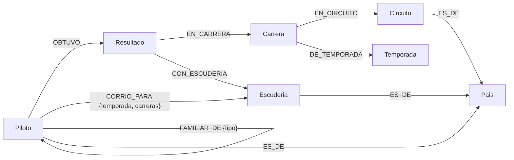
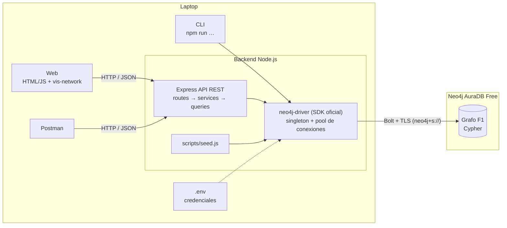

# F1 Paddock Graph — Definición del proyecto

**Materia:** Bases de Datos Avanzadas · **Alumno:** Alfredo Vieto · **Entrega y exposición:** jueves 19 de noviembre de 2026

---

## 1. Resumen

| | |
|---|---|
| **Qué es** | API REST + web que modela la historia de la F1 (1950–2026) como un grafo para explorar conexiones entre pilotos, escuderías, carreras y circuitos |
| **Paradigma** | Red / Grafo (property graph) |
| **Motor en la nube** | Neo4j AuraDB Free (DaaS administrado) |
| **Lenguaje de consulta** | Cypher |
| **Backend** | Node.js + Express + `neo4j-driver` (driver oficial) |
| **Clientes** | Web sencilla (HTML/JS + vis-network), Postman, CLI (scripts npm) |
| **Ejecución** | App en la laptop; la BD siempre en Aura (nada en localhost) |
| **Repositorio** | GitHub privado `proyecto_basededatos` |

---

## 2. Caso de uso y alcance

**Problema.** En F1 las preguntas interesantes son de relaciones: ¿quién fue compañero de quién?, ¿a cuántos "saltos" de compañeros está Checo Pérez de Ayrton Senna?, ¿quién le ganó más veces a su compañero de equipo?, ¿qué pilotos tienen trayectorias parecidas? Son consultas de varios saltos sobre una red, que es justo donde un modelo de grafo rinde mejor que uno relacional.

**Funciones de la aplicación**

- CRUD de **Pilotos** y **Escuderías**.
- **Fichajes**: asignar un piloto a una escudería en una temporada. En la misma transacción se crean o actualizan sus relaciones de compañeros.
- **Consultas de grafo**: camino más corto entre pilotos, vecindad (2 niveles), duelos internos, pilotos similares (compañeros en común), ganadores por circuito, árbol familiar y trayectoria.
- **Health check** que demuestra la conexión a la nube y el tamaño del grafo.

**Fuera de alcance:** login de usuarios, despliegue del backend, tiempos por vuelta, pit stops, sprints y clasificación.

---

## 3. Datos y seeding

- **Fuente:** [F1DB](https://github.com/f1db/f1db), licencia CC BY 4.0 (con atribución en el README).
- **Cobertura:** 1950 hasta el GP de São Paulo 2026 (ronda 20).
- **Tablas usadas** (CSV versionados en `data/f1db/`): `drivers`, `constructors`, `circuits`, `countries`, `grands-prix`, `races`, `races-race-results` y `drivers-family-relationships`.
- **Por qué los CSV van dentro del repo:** Aura no puede leer archivos locales con `LOAD CSV` y el repo es privado. El seed lee los CSV en Node y los envía por el driver en lotes (`UNWIND` de 1 000 filas). Así es reproducible y no depende de APIs externas el día del examen.
- **Idempotente:** usa `MERGE`, así que correrlo dos veces no duplica datos.

| | Estimado | Límite AuraDB Free |
|---|---|---|
| Nodos | ~30 400 | 200 000 |
| Relaciones | ~96 000 | 400 000 |

---

## 4. Modelo de grafo

### 4.1 Nodos

| Label | Propiedades principales | Clave única | Cantidad |
|---|---|---|---|
| `Piloto` | id, nombre, nombreBusqueda, nombreCompleto, abreviatura, numero, fechaNacimiento *(date)*, lugarNacimiento, campeonatos, victorias, podios, poles, carreras, puntos, origen | `id` (ej. `sergio-perez`) | 921 |
| `Escuderia` | id, nombre, nombreCompleto, campeonatos, victorias, origen | `id` (ej. `ferrari`) | 187 |
| `Carrera` | id, anio, ronda, nombre, granPremio, fecha *(date)*, vueltas | `id` (1–1172) | 1 172 |
| `Circuito` | id, nombre, nombreCompleto, tipo, ciudad, ubicacion *(point)*, longitudKm | `id` (ej. `monza`) | 78 |
| `Temporada` | anio | `anio` | 77 |
| `Pais` | id, nombre, continente | `id` (ej. `mexico`) | 249 |
| `Resultado` | id, posicion, posicionTexto, puntos, parrilla, vueltas, tiempo, motivoAbandono, pole, vueltaRapida | `id` (`{carrera}-{orden}`) | 27 731 |

`origen` = `'f1db'` o `'app'` distingue los datos del seed de los creados durante la demo.

### 4.2 Relaciones

| Tipo | Dirección | Propiedades | Cantidad aprox. |
|---|---|---|---|
| `OBTUVO` | (Piloto) → (Resultado) | — | 27 731 |
| `EN_CARRERA` | (Resultado) → (Carrera) | — | 27 731 |
| `CON_ESCUDERIA` | (Resultado) → (Escuderia) | — | 27 731 |
| `EN_CIRCUITO` | (Carrera) → (Circuito) | — | 1 172 |
| `DE_TEMPORADA` | (Carrera) → (Temporada) | — | 1 172 |
| `CORRIO_PARA` | (Piloto) → (Escuderia) | temporada, carreras | 3 566 |
| `COMPANERO_DE` | (Piloto) – (Piloto) \* | temporadas[], escuderias[], carrerasJuntos | 5 428 |
| `FAMILIAR_DE` | (Piloto) → (Piloto) \*\* | tipo (CHILD, PARENT, SIBLING, …) | 86 |
| `ES_DE` | (Piloto \| Escuderia \| Circuito) → (Pais) | — | ~1 186 |

\* Es simétrica: se guarda una sola vez por par y se consulta sin dirección (`-[:COMPANERO_DE]-`).

\*\* Sí tiene dirección: `(a)-[:FAMILIAR_DE {tipo}]->(b)` significa "b es el {tipo} de a". F1DB trae los dos sentidos, por ejemplo `(jos-verstappen)-[:FAMILIAR_DE {tipo:'CHILD'}]->(max-verstappen)` y `(max-verstappen)-[:FAMILIAR_DE {tipo:'PARENT'}]->(jos-verstappen)`.

### 4.3 Diagrama del dominio



### 4.4 Decisiones de diseño (para la defensa)

1. **`Resultado` como nodo intermedio.** Un resultado une tres entidades (piloto, escudería y carrera), y una relación solo conecta dos nodos. Por eso la relación n-aria se modela como nodo (patrón *intermediate node*). De paso resuelve los autos compartidos de los años 50, donde un piloto tiene dos resultados en la misma carrera.
2. **`COMPANERO_DE` materializada.** Se podría derivar de los resultados, pero se precalcula en el seed y se mantiene en cada fichaje. Se paga un poco más al escribir a cambio de lecturas de un solo salto: `shortestPath` recorre solo pilotos.
3. **`CORRIO_PARA` por temporada.** Es un atajo piloto→equipo para trayectorias y plantillas sin recorrer 27k resultados.
4. **`Pais` como nodo y no como texto.** Es un valor compartido y navegable (compatriotas, pilotos por continente). Se cargan los 249 países para poder crear pilotos de cualquier país, por ejemplo Costa Rica.
5. **Convenciones de Neo4j:** labels en PascalCase y en singular, relaciones en UPPER_SNAKE_CASE con verbo, propiedades en camelCase. Los identificadores van sin ñ ni acentos.
6. **IDs legibles** (los slugs de F1DB) en vez del id interno (`elementId`), que no es estable para uso externo.

### 4.5 Constraints e índices (`scripts/schema.cypher`)

```cypher
CREATE CONSTRAINT piloto_id      IF NOT EXISTS FOR (n:Piloto)    REQUIRE n.id   IS UNIQUE;
CREATE CONSTRAINT escuderia_id   IF NOT EXISTS FOR (n:Escuderia) REQUIRE n.id   IS UNIQUE;
CREATE CONSTRAINT carrera_id     IF NOT EXISTS FOR (n:Carrera)   REQUIRE n.id   IS UNIQUE;
CREATE CONSTRAINT circuito_id    IF NOT EXISTS FOR (n:Circuito)  REQUIRE n.id   IS UNIQUE;
CREATE CONSTRAINT temporada_anio IF NOT EXISTS FOR (n:Temporada) REQUIRE n.anio IS UNIQUE;
CREATE CONSTRAINT pais_id        IF NOT EXISTS FOR (n:Pais)      REQUIRE n.id   IS UNIQUE;
CREATE CONSTRAINT resultado_id   IF NOT EXISTS FOR (n:Resultado) REQUIRE n.id   IS UNIQUE;

CREATE TEXT INDEX piloto_busqueda IF NOT EXISTS FOR (n:Piloto)  ON (n.nombreBusqueda);
CREATE INDEX carrera_anio         IF NOT EXISTS FOR (n:Carrera) ON (n.anio);
CREATE INDEX corrio_para_temp     IF NOT EXISTS FOR ()-[r:CORRIO_PARA]-() ON (r.temporada);
```

Cada constraint de unicidad crea un índice. Eso hace que el nodo de inicio de cada traversal (`{id: $id}`) se encuentre con una búsqueda en índice y no recorriendo todos los nodos.

---

## 5. API REST

| Método | Ruta | Descripción | Tipo |
|---|---|---|---|
| GET | `/api/health` | Conexión a Aura + conteo de nodos y relaciones | Infra |
| GET | `/api/pilotos?buscar=&limite=` | Listar o buscar pilotos | CRUD · R |
| GET | `/api/pilotos/:id` | Detalle | CRUD · R |
| POST | `/api/pilotos` | Crear | CRUD · C |
| PATCH | `/api/pilotos/:id` | Actualizar | CRUD · U |
| DELETE | `/api/pilotos/:id` | Eliminar (en cascada con sus resultados) | CRUD · D |
| GET / POST / PATCH / DELETE | `/api/escuderias[/:id]` | Igual que pilotos (no deja borrar si hay resultados históricos) | CRUD |
| POST | `/api/fichajes` | Piloto → escudería en una temporada (+ compañeros) | CRUD de relación |
| DELETE | `/api/fichajes/:pilotoId/:escuderiaId/:temporada` | Quitar el fichaje | CRUD de relación |
| GET | `/api/grafo/camino?desde=&hasta=` | Camino más corto entre dos pilotos | Búsqueda de caminos |
| GET | `/api/grafo/pilotos/:id/vecindad` | Compañeros y compañeros de compañeros | Vecindad |
| GET | `/api/grafo/pilotos/:id/duelos` | Head-to-head contra cada compañero | Patrón |
| GET | `/api/grafo/pilotos/:id/similares` | Recomendación por compañeros en común | Patrón (cierre triádico) |
| GET | `/api/grafo/pilotos/:id/trayectoria` | Equipos por temporada | Traversal |
| GET | `/api/grafo/pilotos/:id/familia` | Árbol familiar | Traversal variable |
| GET | `/api/grafo/circuitos/:id/ganadores` | Máximos ganadores en un circuito | Traversal multi-salto |

Códigos de respuesta: `200/201` éxito · `400` validación · `404` no existe · `409` id duplicado o borrado bloqueado · `503` sin conexión a Aura.

---

## 6. Catálogo de consultas clave (Cypher)

> **Enteros:** el driver de JavaScript manda los `number` como Float. Los parámetros enteros (`temporada`, `limite`, `numero`) se envían con `neo4j.int()`, y en el seed se convierten dentro de Cypher con `toInteger()`.

### Q1 · Camino más corto (grados de separación)
```cypher
MATCH (a:Piloto {id: $desde}), (b:Piloto {id: $hasta})
MATCH p = shortestPath((a)-[:COMPANERO_DE*..15]-(b))
RETURN [n IN nodes(p) | {id: n.id, nombre: n.nombre}]                          AS pilotos,
       [r IN relationships(p) | {temporadas: r.temporadas, escuderias: r.escuderias}] AS conexiones,
       length(p)                                                                AS grados;
```

### Q2 · Vecindad a 2 niveles
```cypher
MATCH path = (p:Piloto {id: $id})-[:COMPANERO_DE*1..2]-(v:Piloto)
WHERE v <> p
WITH v, min(length(path)) AS distancia
RETURN v.id AS id, v.nombre AS nombre, distancia
ORDER BY distancia, nombre;
```

### Q3 · Duelos internos (head-to-head contra compañeros)
```cypher
MATCH (p:Piloto {id: $id})-[:OBTUVO]->(r1:Resultado)-[:EN_CARRERA]->(c:Carrera)
      <-[:EN_CARRERA]-(r2:Resultado)<-[:OBTUVO]-(rival:Piloto)
MATCH (r1)-[:CON_ESCUDERIA]->(e:Escuderia)<-[:CON_ESCUDERIA]-(r2)
WHERE rival <> p AND r1.posicion IS NOT NULL AND r2.posicion IS NOT NULL
RETURN rival.nombre AS companero, e.nombre AS escuderia,
       count(*)                                              AS carrerasJuntos,
       sum(CASE WHEN r1.posicion < r2.posicion THEN 1 ELSE 0 END) AS ganadas,
       sum(CASE WHEN r2.posicion < r1.posicion THEN 1 ELSE 0 END) AS perdidas
ORDER BY carrerasJuntos DESC;
```

### Q4 · Pilotos similares (recomendación por cierre triádico)
```cypher
MATCH (p:Piloto {id: $id})-[:COMPANERO_DE]-(comun:Piloto)-[:COMPANERO_DE]-(otro:Piloto)
WHERE otro <> p AND NOT EXISTS { (p)-[:COMPANERO_DE]-(otro) }
RETURN otro.id AS id, otro.nombre AS nombre,
       count(DISTINCT comun)                  AS companerosEnComun,
       collect(DISTINCT comun.nombre)[0..3]   AS ejemplos
ORDER BY companerosEnComun DESC
LIMIT 10;
```

### Q5 · Ganadores en un circuito (traversal de 3 saltos)
```cypher
MATCH (ci:Circuito {id: $id})<-[:EN_CIRCUITO]-(c:Carrera)
      <-[:EN_CARRERA]-(r:Resultado {posicion: 1})<-[:OBTUVO]-(p:Piloto)
RETURN p.nombre AS piloto, count(*) AS victorias, collect(c.anio) AS anios
ORDER BY victorias DESC
LIMIT 10;
```

### Q6 · Árbol familiar (longitud variable)
```cypher
MATCH path = (p:Piloto {id: $id})-[:FAMILIAR_DE*1..3]->(f:Piloto)
WHERE f <> p
RETURN DISTINCT f.id AS id, f.nombre AS nombre,
       [r IN relationships(path) | r.tipo] AS parentesco, length(path) AS saltos
ORDER BY saltos;
```

### Q7 · Trayectoria
```cypher
MATCH (p:Piloto {id: $id})-[cp:CORRIO_PARA]->(e:Escuderia)
RETURN cp.temporada AS temporada, e.id AS escuderiaId, e.nombre AS escuderia, cp.carreras AS carreras
ORDER BY temporada;
```

### Q8 · Fichaje (dos sentencias dentro de una sola transacción `executeWrite`)
```cypher
// 1) crear la relación piloto → escudería
MATCH (p:Piloto {id: $pilotoId}), (e:Escuderia {id: $escuderiaId})
MERGE (p)-[cp:CORRIO_PARA {temporada: $temporada}]->(e)
  ON CREATE SET cp.carreras = 0
RETURN p.id AS piloto, e.id AS escuderia;

// 2) conectar con los compañeros de esa escudería en esa temporada
MATCH (p:Piloto {id: $pilotoId})-[:CORRIO_PARA {temporada: $temporada}]->(e:Escuderia {id: $escuderiaId})
MATCH (e)<-[:CORRIO_PARA {temporada: $temporada}]-(otro:Piloto)
WHERE otro <> p
MERGE (p)-[c:COMPANERO_DE]-(otro)
  ON CREATE SET c.temporadas = [$temporada], c.escuderias = [e.id], c.carrerasJuntos = 0
  ON MATCH  SET c.temporadas = CASE WHEN $temporada IN c.temporadas THEN c.temporadas ELSE c.temporadas + $temporada END,
                c.escuderias = CASE WHEN e.id IN c.escuderias THEN c.escuderias ELSE c.escuderias + e.id END
RETURN collect(otro.nombre) AS nuevosCompaneros;
```

### CRUD de Piloto
```cypher
// CREATE
MATCH (pa:Pais {id: $paisId})
CREATE (p:Piloto {id: $id, nombre: $nombre, nombreBusqueda: $nombreBusqueda, abreviatura: $abreviatura,
                  numero: $numero, fechaNacimiento: date($fechaNacimiento),
                  origen: 'app', creadoEn: datetime()})-[:ES_DE]->(pa)
RETURN p;

// READ (detalle con proyección de mapa)
MATCH (p:Piloto {id: $id})
OPTIONAL MATCH (p)-[:ES_DE]->(pa:Pais)
RETURN p {.*, pais: pa.nombre} AS piloto;

// READ (búsqueda; usa el TEXT INDEX)
MATCH (p:Piloto)
WHERE $buscar IS NULL OR p.nombreBusqueda CONTAINS $buscar
RETURN p {.id, .nombre, .abreviatura, .victorias} AS piloto
ORDER BY p.victorias DESC, p.nombre
LIMIT $limite;

// UPDATE (campos permitidos filtrados en el servicio)
MATCH (p:Piloto {id: $id})
SET p += $cambios, p.actualizadoEn = datetime()
RETURN p;

// DELETE (cascada manual: Neo4j no tiene ON DELETE CASCADE)
MATCH (p:Piloto {id: $id})
CALL (p) {
  MATCH (p)-[:OBTUVO]->(r:Resultado)
  DETACH DELETE r
}
DETACH DELETE p;
```

### Health
```cypher
MATCH (n) WITH count(n) AS nodos
MATCH ()-[r]->() RETURN nodos, count(r) AS relaciones;
```

---

## 7. Arquitectura



**Manejo del driver (puntos de la rúbrica "Código e Integración Cloud")**

- **Un solo `driver` por proceso** (singleton) con pool de conexiones; cada request abre una sesión corta y la cierra.
- **`driver.verifyConnectivity()`** al arrancar: si el `.env` está mal, la app falla de inmediato con un mensaje claro.
- **Transacciones administradas** (`executeRead` / `executeWrite`) que reintentan solas ante errores transitorios de red o del clúster.
- **Siempre con parámetros `$param`**, nunca concatenando strings: evita Cypher injection y permite reutilizar el plan de ejecución.
- **Enteros:** Neo4j usa enteros de 64 bits. Para `LIMIT`/`SKIP` se envían con `neo4j.int()`, y al leer se usa `disableLosslessIntegers` porque nuestros números son chicos.
- **Credenciales solo en `.env`** (con `dotenv`). `.env` va en `.gitignore`; se versiona `.env.example`.
- **Cierre limpio** con `driver.close()` al recibir SIGINT.

---

## 8. Estructura del repositorio

```
proyecto_basededatos/
├── CLAUDE.md               # contexto y reglas para Claude Code
├── data/f1db/              # CSV de F1DB (CC BY 4.0) que usa el seed
├── docs/
│   ├── definicion-proyecto.md   # este documento (fuente de verdad del modelo)
│   ├── plan-desarrollo.md       # fases y tareas de desarrollo
│   └── requerimientos.md        # software, dependencias e instalación
├── postman/                # colección + environment de Postman
├── public/                 # web: index.html, app.js, styles.css
├── scripts/
│   ├── check.js            # prueba de conexión a Aura
│   ├── schema.cypher       # constraints e índices
│   ├── schema.js           # aplica schema.cypher
│   ├── seed.js             # carga inicial por lotes (idempotente)
│   ├── reset.js            # vacía la BD por lotes
│   ├── limpiar-demo.js     # borra solo lo creado en la demo
│   └── smoke.js            # prueba rápida de endpoints
├── src/
│   ├── config/
│   │   ├── env.js          # lee y valida .env
│   │   └── neo4j.js        # driver singleton
│   ├── queries/            # Cypher por módulo (pilotos, escuderias, fichajes, grafo)
│   ├── services/           # lógica + transacciones
│   ├── routes/             # routers de Express
│   ├── middleware/         # manejo de errores
│   ├── utils/              # validación, normalización de texto, tipos de Neo4j
│   ├── app.js              # configuración de Express
│   ├── cli.js              # consultas desde la terminal
│   └── server.js
├── .env.example
├── .gitignore
├── package.json
└── README.md
```

**Scripts npm:** `npm run schema` · `npm run seed` · `npm run reset` · `npm start` · `npm run cli -- camino sergio-perez ayrton-senna`

**`.env.example`**
```
NEO4J_URI=neo4j+s://<id-instancia>.databases.neo4j.io
NEO4J_USERNAME=
NEO4J_PASSWORD=
NEO4J_DATABASE=
PORT=3000
```

---

## 9. Configuración previa (checklist)

- [x] **Aura:** instancia AuraDB Free creada. El archivo de credenciales `Neo4j-dd53b483-Created-2026-11-18.txt` está en la raíz del proyecto y está en `.gitignore`.
- [ ] **Software:** Node 22/24 LTS, Git, VS Code con Claude Code y Postman. Ver `docs/requerimientos.md`.
- [ ] **Repo:** se conecta la carpeta con el repo de GitHub (`git init` + `remote add`) en la Fase 0 de `docs/plan-desarrollo.md`.
- [ ] **`.env`:** se genera desde el archivo de credenciales en la Fase 0. Nunca se sube a GitHub.
- [ ] **OneDrive:** la carpeta se sincroniza y `node_modules` tiene miles de archivos. Si `npm install` falla con `EPERM` o va muy lento, pausa la sincronización mientras instala.
- [ ] **Red de la universidad:** el driver usa el puerto 7687 (Bolt). Hay que probar la conexión desde el Wi-Fi del campus antes del jueves; si está bloqueado, usar el hotspot del celular.

---

## 10. Guion de la demo (4 min)

| Min | Acción | Qué demuestra |
|---|---|---|
| 0:00 | `GET /api/health`: host de Aura + nodos y relaciones | Conexión a la nube |
| 0:30 | Web: buscar "Pérez", ver ficha y trayectoria | Lectura + traversal |
| 1:00 | Camino más corto Sergio Pérez → Ayrton Senna (4 saltos) dibujado | Búsqueda de caminos |
| 1:45 | Crear piloto "Alfredo Vieto" (Costa Rica) y ficharlo con Ferrari 2026 → queda como compañero de Leclerc y Hamilton | Create + relación en una transacción |
| 2:30 | Camino Alfredo Vieto → Juan Manuel Fangio | El nuevo dato ya forma parte del grafo |
| 3:00 | Update (número) y verlo en la consola de Aura | Persistencia en la nube |
| 3:30 | Delete (`DETACH DELETE`): el camino deja de existir | Delete + integridad |

Respaldo: la misma secuencia en la colección de Postman.

---

## 11. Plan al jueves

El desglose por fases, con tareas y criterios de terminado, está en `docs/plan-desarrollo.md`.

| Cuándo | Qué |
|---|---|
| Martes noche | Requerimientos instalados (Fase R) + Fases 0–3: repo, scaffold, schema y seed en Aura |
| Miércoles | Fases 4–9: API, consultas de grafo, Postman, web, CLI y README |
| Miércoles noche | Fase 10 (smoke test y ensayo) + contenido del PDF en tu plantilla |
| Jueves antes del examen | Confirmar que Aura esté *Running*, probar la red del campus y ensayar la demo |

---

## 12. Justificación vs SQL (borrador para el PDF)

| Pregunta | SGBD relacional | Grafo (Neo4j) |
|---|---|---|
| ¿A cuántos compañeros de distancia están A y B? | CTE recursiva sobre un auto-JOIN de una tabla puente. Explora todas las rutas y hay que controlar ciclos y profundidad a mano. | `shortestPath` (BFS bidireccional) en una línea |
| Compañeros de compañeros | Dos o más self-JOINs; cada nivel extra es otro JOIN | `*1..2` en el patrón |
| Duelos internos | JOIN resultados × resultados por carrera y escudería | Patrón sobre el nodo `Carrera` |
| Agregar parentesco familiar | Tabla nueva + FKs + migración | Una relación nueva, sin migrar el esquema |
| Costo por salto | Una búsqueda en índice por cada JOIN; crece con el tamaño de las tablas | Solo depende de los vecinos visitados (*index-free adjacency*) |

**Equivalente en SQL de Q1 (PostgreSQL):**
```sql
WITH RECURSIVE ruta(piloto, camino, saltos) AS (
  SELECT 'sergio-perez', ARRAY['sergio-perez'], 0
  UNION ALL
  SELECT c.piloto_b, r.camino || c.piloto_b, r.saltos + 1
  FROM ruta r
  JOIN companeros c ON c.piloto_a = r.piloto
  WHERE c.piloto_b <> ALL (r.camino)   -- evitar ciclos a mano
    AND r.saltos < 6                   -- límite de profundidad a mano
)
SELECT camino FROM ruta
WHERE piloto = 'ayrton-senna'
ORDER BY saltos
LIMIT 1;
```

**Dónde SQL sería igual o mejor:** las tablas de posiciones del campeonato (sumas y agregados planos). El proyecto no compite ahí; su núcleo son las relaciones.
