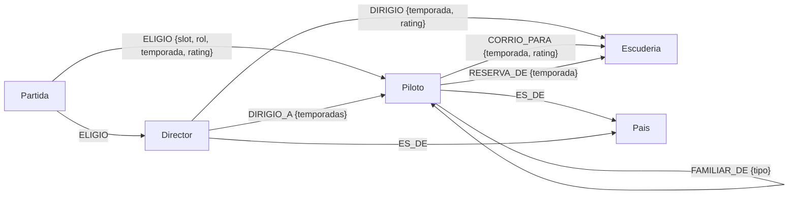

# 24-0 · F1 Paddock Draft — Documento del proyecto (versión juego)

**Materia:** Bases de Datos Avanzadas · **Alumno:** Alfredo Vieto · **Entrega y exposición:** jueves 19 de noviembre de 2026
**Para:** Claude Code (VS Code). Este documento es la **única fuente de verdad del proyecto**. El proyecto es el juego más una pestaña **Grafo** para explorar cómo se relacionan los pilotos y una pestaña **Directores** (CRUD).

**Alcance de los datos:** solo temporadas **2000–2025** (2026 sigue en curso). El seed solo carga pilotos, escuderías y directores de esos años.

---

## 0. Resumen

| | |
|---|---|
| **Qué es** | Juego tipo *17-0* (NFL) y *82-0* (NBA) para F1. En cada ronda sale al azar una **escudería + temporada (2000–2025)** y eliges a un piloto o al director de ese equipo y año. Con 5 elecciones armas un equipo, se simula una temporada de **24 carreras** y la meta es ir **24-0**, ganar el campeonato de constructores y que uno de tus pilotos sea campeón |
| **Por qué es un proyecto de grafos** | El puntaje depende de la **química**, que son las relaciones del grafo entre las 5 personas que elegiste: si fueron compañeros, si el director los dirigió, si son familia o compatriotas. Calcularla es una consulta de **subgrafo inducido** con búsqueda de caminos |
| **Paradigma / motor** | Grafo · Neo4j AuraDB Free (nube) · Cypher |
| **Stack** | Node.js 22/24 + Express 5 + `neo4j-driver` 6 + HTML/JS vanilla + vis-network |
| **Componentes** | Seed de F1DB filtrado a 2000–2025, datos de **directores** (CSV curado), ratings por temporada, nodos `Director` y `Partida`, relaciones `DIRIGIO`, `DIRIGIO_A`, `RESERVA_DE` y `ELIGIO`, el motor del juego, la API de partidas y directores, la pestaña **Grafo** y la web del juego |
| **Qué no se modela** | Carreras, resultados y circuitos como nodos: los resultados de carrera solo se leen en el seed para derivar `CORRIO_PARA` y `COMPANERO_DE` |

---

## 1. Reglas del juego

### 1.1 Flujo de una partida
1. **Jugar** (sin registro: no se pide nombre ni equipo; la partida se identifica por sus 5 elegidos).
2. **Girar:** sale una escudería + temporada al azar entre 2000 y 2025 (por ejemplo *Williams 2003*). Solo el **primer** giro es manual; después de cada elección el siguiente giro arranca **solo**.
3. Se muestran los **candidatos** de ese sorteo: los pilotos que corrieron ese año, los pilotos de reserva de ese año y el director (o directores) de ese año. Cada uno trae su **rating** y una **pista de química** que dice con quién de tu equipo actual conecta.
4. El jugador elige **un** candidato para un puesto libre compatible.
5. Se repiten los pasos 2 a 4 hasta llenar los **5 puestos** (5 rondas). Si nadie del sorteo cabe en los puestos libres, se gira de nuevo automáticamente (giro gratis).
6. **Simular temporada:** se calcula el puntaje (base + química), se simulan 24 carreras y se muestran el récord (por ejemplo **19-5**) y los campeonatos.
7. La partida queda guardada en Aura y aparece en el **Ranking**.

### 1.2 Puestos (5)

| Puesto | Acepta | Peso en el puntaje base |
|---|---|---|
| `DIRECTOR` | Director | 0.30 |
| `PILOTO_1` | Piloto | 0.25 |
| `PILOTO_2` | Piloto | 0.25 |
| `FLEX` | Piloto **o** Director | 0.15 |
| `RESERVA` | Piloto | 0.05 |

- No se puede elegir a la misma persona dos veces, aunque venga de otro año.
- La elección es definitiva: no hay deshacer, igual que en los juegos originales.
- **Re-rolls:** 1 de escudería (mantiene el año y cambia el equipo) y 1 de año (mantiene el equipo y cambia el año) por partida. Si no hay alternativa, por ejemplo *Brawn* solo existe en 2009, responde 409 `SIN_OPCIONES` y **no** se gasta el re-roll.
- Si el único puesto libre es `DIRECTOR`, el sorteo solo saca escuderías-temporada que tengan director registrado.
- Si ningún candidato del sorteo cabe en tus puestos libres (por ejemplo, todos ya están en tu equipo), el siguiente giro es **gratis** y no gasta re-roll, para que la partida nunca se trabe.

### 1.3 Rating por temporada (0–100, relativo a su época)

Se calcula en el seed con las clasificaciones finales de F1DB, así un campeón del año 2000 compite parejo con uno de 2024 aunque el sistema de puntos haya cambiado:

```
rating = round(100 × (0.6 × puntos / puntosDelCampeón  +  0.4 × (1 − (posición − 1) / (N − 1))))
```

- **Piloto** (`CORRIO_PARA.rating`): su posición y puntos en el campeonato de pilotos de ese año. El campeón vale 100. Sin clasificación vale 20.
- **Director** (`DIRIGIO.rating`): la posición y puntos de su escudería en el campeonato de constructores de ese año.
- **Reserva que no corrió ese año:** 30 fijo.
- Ejemplos con los datos reales: Verstappen 2023 = 100, Pérez 2023 = 68, Alonso 2023 = 56, Red Bull 2023 = 100, Haas 2016 = 14.

### 1.4 Química (la parte de grafos)

Se revisa cada uno de los **10 pares** posibles entre los 5 elegidos:

| Conexión en el grafo | Condición | Puntos |
|---|---|---|
| `COMPANERO_DE` | Los dos pilotos fueron compañeros de equipo (cualquier año) | +3 |
| `DIRIGIO_A` | El director dirigió a ese piloto | +3 |
| `FAMILIAR_DE` | Son familia | +4 |
| `ES_DE` común | Misma nacionalidad | +1 |
| Cercanía | Sin conexión directa, pero a **2 saltos** por `COMPANERO_DE`/`DIRIGIO_A` (un conocido en común) | +1 |
| **Tope total** | | **+15** |

Un par puede sumar varias conexiones (por ejemplo compañeros y compatriotas = +4). Los valores viven en `src/juego/reglas.js`, nunca en el Cypher, para poder ajustarlos sin tocar las consultas.

### 1.5 Puntaje y simulación

```
base     = Σ (peso del puesto × rating)                  // 0–100
puntaje  = base + min(química, 15)                       // 0–115
pGanar   = clamp(1 / (1 + e^(−(puntaje − 74) / 5)), 0.01, 0.96)
victorias = número de carreras ganadas de 24 (una tirada por carrera con pGanar)
```

- **Generador aleatorio con semilla** (`mulberry32`, semilla = hash del id de la partida): si se vuelve a simular la misma partida da el mismo resultado.
- **Titulares:** los **2 pilotos con mejor rating** entre `PILOTO_1`, `PILOTO_2` y `FLEX` (si `FLEX` es piloto). Se reparten las victorias del equipo en proporción a su rating. La reserva no corre.
- **Campeón de constructores:** victorias del equipo ≥ 12.
- **Campeón de pilotos:** el titular con más victorias tiene ≥ 9.
- **Récord:** `victorias-derrotas` (por ejemplo `19-5`). **24-0** es la temporada perfecta.

Curva calibrada (`mu = 74`, `s = 5`, `pMax = 0.96`):

| Puntaje | pGanar | Victorias esperadas | P(24-0) |
|---|---|---|---|
| 60 | 0.06 | 1.4 | 0 % |
| 70 | 0.31 | 7.4 | 0 % |
| 74 | 0.50 | 12.0 | 0 % |
| 80 | 0.77 | 18.4 | 0 % |
| 85 | 0.90 | 21.6 | 8 % |
| 90+ | 0.96 | 23.0 | 38 % |

El tope `pMax = 0.96` hace que incluso el mejor equipo posible tenga solo ~38 % de ir 24-0, igual que en los juegos originales: la temporada perfecta tiene que costar.

**Calibración ya hecha con los datos reales** (incluye los directores): se simularon 20 000 drafts con un jugador que toma al mejor disponible y aprovecha la química. Dio una mediana de 58.5 puntos y un p90 de 82.9. Con esta curva, el campeonato de constructores sale en **22.6 %** de las partidas y el 24-0 en **3.0 %**. Las metas son 15–25 % y 1–3 %. `npm run calibrar` (Fase J3) vuelve a correr esa simulación por si se cambian pesos o química.

---

## 2. Datos de directores de equipo

### 2.1 De dónde salen
- **Ni F1DB, ni Jolpica/Ergast, ni las librerías de npm traen directores históricos.** Las librerías que existen son wrappers de Ergast (`f1-api`, `f1-stats`) o scrapers de la parrilla actual de formula1.com (`f1-api-node`).
- **Fuente elegida: Wikipedia.** Cada artículo de escudería tiene *Team principal(s)* en su ficha y la historia del cargo en el texto. Licencia CC BY-SA → atribución en el README.
- En F1DB hay **39 escuderías y 275 escuderías-temporada** entre 2000 y 2025 (tabla del Anexo A).

### 2.2 Archivo `data/curado/directores.csv` ✅ ya incluido

**El CSV ya está armado.** Se construyó con investigación web (Wikipedia y prensa especializada), y los casos dudosos se verificaron uno por uno: Jaguar, Toyota, Manor, Lotus, Minardi, Benetton, Honda, Force India y Alpine.
- **93 filas · 67 personas · cobertura 275/275** escuderías-temporada, sin referencias rotas a F1DB.
- **7 personas también fueron pilotos** (multi-label): Jackie Stewart, Bobby Rahal, Niki Lauda, Alain Prost, Aguri Suzuki, Christijan Albers y Luis Pérez-Sala.
- Columna extra `confianza` (`alta` / `media`). Las filas `media` son cargos poco claros (racing director, interino, deputy) y se revisan si sobra tiempo.
- Es un proyecto escolar: los datos son razonables, no oficiales. Si algo está mal, se corrige con el CRUD de directores.

```csv
directorId,nombre,paisId,pilotoId,escuderiaId,desde,hasta,notas,fuente,confianza
christian-horner,Christian Horner,united-kingdom,,red-bull,2005,2025,salió en julio de 2025,Wikipedia – Red Bull Racing,alta
alain-prost,Alain Prost,france,alain-prost,prost,2000,2001,dueño y jefe de equipo; también fue piloto,Wikipedia – Prost Grand Prix,alta
```

Reglas con las que se armó (sirven si se agregan filas):
- **Una fila por periodo continuo** de una persona en una escudería (`escuderiaId` = id de F1DB del Anexo A). Años inclusivos, dentro de 2000–2025.
- `directorId`: slug en minúsculas, sin acentos (`frederic-vasseur`).
- `paisId`: id de país de F1DB (`united-kingdom`, `italy`, `france`, `germany`, `austria`, `japan`, `india`, `switzerland`, `spain`…).
- `pilotoId`: **solo** si la persona también es piloto en F1DB (por ejemplo Alain Prost, Niki Lauda, Aguri Suzuki, Luis Pérez-Sala). En ese caso `directorId = pilotoId`, porque es el **mismo nodo** con dos labels (`:Piloto:Director`).
- **Cambio a mitad de temporada:** los dos directores incluyen ese año y se explica en `notas` (por ejemplo "desde julio").
- Si el cargo se llamaba distinto (managing director, racing director, CEO que dirigía al equipo), se usa a quien Wikipedia presenta como líder del equipo y se anota en `notas`.
- `fuente`: referencia usada (artículo de Wikipedia o medio verificado).
- `confianza`: `alta` si el cargo es claro; `media` si fue interino, compartido o con otro título.

### 2.3 Validador `npm run validar-directores`
- Cada escudería-temporada 2000–2025 con resultados en F1DB tiene **≥ 1 director**. Imprime la cobertura (por ejemplo `275/275`) y la lista de faltantes.
- `escuderiaId`, `paisId` y `pilotoId` existen en los CSV de F1DB.
- No hay filas duplicadas ni rangos invertidos (`desde > hasta`).
- Sale con código 1 si algo falla. **El juego funciona aunque falten directores:** esas escuderías-temporada simplemente no ofrecen director como candidato.

---

## 3. Modelo de grafo

### 3.0 Modelo base (solo 2000–2025)

El seed lee F1DB y **filtra a las temporadas 2000–2025**. Solo se crean los pilotos y escuderías que aparecen en esos años (más los 7 directores que también fueron pilotos, aunque hayan corrido antes de 2000).

| Label | Propiedades | Clave | Cantidad |
|---|---|---|---|
| `Pais` | id, nombre, alpha3, continente | `id` | los que use algún piloto, escudería o director |
| `Escuderia` | id, nombre, nombreCompleto | `id` | 39 |
| `Piloto` | id, nombre, nombreBusqueda, nombreCompleto, abreviatura, numero, fechaNacimiento | `id` | ~190 (129 titulares + reservas + pilotos-director) |

| Relación | Dirección | Propiedades | Origen |
|---|---|---|---|
| `CORRIO_PARA` | (Piloto) → (Escuderia) | temporada, carreras (+ rating… del §3.2) | derivada en JS de los resultados 2000–2025 |
| `COMPANERO_DE` | (Piloto) — (Piloto), una por par | temporadas[], escuderias[], carrerasJuntos | derivada en JS: misma carrera y misma escudería |
| `FAMILIAR_DE` | (Piloto) → (Piloto) | tipo | `drivers-family-relationships`, solo entre pilotos cargados |
| `ES_DE` | (Piloto \| Escuderia \| Director) → (Pais) | — | nacionalidad / país |

Como se borró todo lo demás, el seed es **uno solo** (`npm run seed`): carga el modelo base y luego lo del juego. Ya no existe `seed-juego.js`.

### 3.1 Nodos nuevos del juego

| Label | Propiedades | Clave | Cantidad aprox. |
|---|---|---|---|
| `Director` | id, nombre, nombreBusqueda, origenDirector (`'curado'` o `'app'`) | `id` | 67 (60 nodos nuevos + 7 pilotos con label extra) |
| `Partida` | id (UUID), jugador, nombreEquipo, estado (`'en_curso'`/`'terminada'`), ronda, rerollEscuderia, rerollAnio, sorteoEscuderiaId, sorteoTemporada, semilla, base, quimica, puntaje, victorias, derrotas, campeonConstructores, campeonPilotos, campeonPilotosId, creadaEn, terminadaEn | `id` | las que se jueguen |

**Multi-label:** si un director también fue piloto, se agrega el label `:Director` a su nodo `:Piloto`. Es la misma persona con dos roles, algo natural en un grafo de propiedades y que en SQL obligaría a duplicar la fila o a crear una tabla de roles.

### 3.2 Relaciones nuevas o ampliadas

| Tipo | Dirección | Propiedades | Origen | Cantidad aprox. |
|---|---|---|---|---|
| `CORRIO_PARA` *(ampliada)* | (Piloto) → (Escuderia) | + rating, posicionCampeonato, puntosTemporada, campeon | seed, a partir de `seasons-driver-standings` | 3 566 (todas) |
| `RESERVA_DE` | (Piloto) → (Escuderia) | temporada | seed, a partir de `seasons-entrants-drivers` (`testDriver = true`) | 177 (2000–2025; 178 filas con 1 repetida) |
| `DIRIGIO` | (Director) → (Escuderia) | temporada, rating, posicionConstructores, campeon, notas | seed, a partir de `directores.csv` + `seasons-constructor-standings` | 300 |
| `DIRIGIO_A` | (Director) → (Piloto) | temporadas[], escuderias[] | **derivada con Cypher** a partir de `DIRIGIO` + `CORRIO_PARA` | ~370 |
| `ES_DE` *(reutilizada)* | (Director) → (Pais) | — | seed | ~60 |
| `ELIGIO` | (Partida) → (Piloto \| Director) | slot, rol, ronda, temporada, escuderiaId, rating | juego | 5 por partida |

### 3.3 Diagrama



### 3.4 Decisiones de diseño (para la defensa)
1. **`DIRIGIO_A` derivada en Cypher, no en JS.** `COMPANERO_DE` se calculó en Node; esta se calcula con un patrón del propio grafo (Q-J9). Así quedan mostradas las dos formas de materializar relaciones.
2. **Rating guardado en la relación, no en el nodo.** El rating depende de la temporada, y la temporada vive en `CORRIO_PARA` y `DIRIGIO`. Un piloto tiene un rating distinto cada año.
3. **`ELIGIO` guarda una foto** (rating, temporada, escudería) del momento de la elección. Si después se corrige un dato, las partidas terminadas no cambian.
4. **La aleatoriedad del sorteo la pone la BD** (`ORDER BY rand()`), y la del resultado la pone el servidor con semilla, para que sea reproducible.
5. **La lógica del juego vive en JS (`src/juego/`); el grafo resuelve las relaciones.** Cada capa hace lo que mejor sabe hacer.
6. **Pilotos que cambiaron de equipo a mitad de año** (por ejemplo Lawson 2025): F1DB tiene un solo registro por piloto-año en el campeonato, así que el mismo rating queda en todas sus `CORRIO_PARA` de ese año.
7. **Cercanía (+1):** `shortestPath *..2` también encuentra caminos de 1 salto. El +1 solo se da si `saltos = 2` **y** el par no tiene ninguna conexión directa.
8. **Piloto que también es director:** si ya tiene `ES_DE` (nacionalidad de F1DB), el seed no le agrega un segundo país desde `directores.csv`.

### 3.5 Schema adicional (agregar a `scripts/schema.cypher`)

```cypher
CREATE CONSTRAINT director_id IF NOT EXISTS FOR (n:Director) REQUIRE n.id IS UNIQUE;
CREATE CONSTRAINT partida_id  IF NOT EXISTS FOR (n:Partida)  REQUIRE n.id IS UNIQUE;

CREATE TEXT INDEX director_busqueda IF NOT EXISTS FOR (n:Director) ON (n.nombreBusqueda);
CREATE INDEX partida_estado       IF NOT EXISTS FOR (n:Partida) ON (n.estado);
CREATE INDEX partida_puntaje      IF NOT EXISTS FOR (n:Partida) ON (n.puntaje);
CREATE INDEX dirigio_temp         IF NOT EXISTS FOR ()-[r:DIRIGIO]-()    ON (r.temporada);
CREATE INDEX reserva_temp         IF NOT EXISTS FOR ()-[r:RESERVA_DE]-() ON (r.temporada);
```

---

## 4. Catálogo de consultas del juego (Cypher)

> Siguen vigentes las reglas de `CLAUDE.md`: siempre `$parametros`, enteros con `neo4j.int()` y todo el Cypher en `src/queries/`. Las del juego van en `src/queries/juego.js` y `src/queries/directores.js`.

### Q-J1 · Sorteo (escudería-temporada al azar)
```cypher
MATCH (e:Escuderia)<-[cp:CORRIO_PARA]-(:Piloto)
WHERE $anioMin <= cp.temporada <= $anioMax
  AND ($escuderiaFija   IS NULL OR e.id = $escuderiaFija)
  AND ($temporadaFija   IS NULL OR cp.temporada = $temporadaFija)
  AND ($excluirEscuderia IS NULL OR e.id <> $excluirEscuderia)
  AND ($excluirTemporada IS NULL OR cp.temporada <> $excluirTemporada)
WITH DISTINCT e, cp.temporada AS temporada
WHERE NOT $requiereDirector
   OR EXISTS { (:Director)-[:DIRIGIO {temporada: temporada}]->(e) }
RETURN e.id AS escuderiaId, e.nombre AS escuderia, temporada
ORDER BY rand()
LIMIT 1;
```
Re-roll de escudería: `temporadaFija = actual` y `excluirEscuderia = actual`. Re-roll de año: `escuderiaFija = actual` y `excluirTemporada = actual`. El resultado se guarda en la `Partida` (`sorteoEscuderiaId`, `sorteoTemporada`), así que si se recarga la página no cambia.

### Q-J2 · Candidatos del sorteo + pista de química (traversal + vecindad)
```cypher
MATCH (e:Escuderia {id: $escuderiaId})
CALL (e) {
  MATCH (p:Piloto)-[cp:CORRIO_PARA {temporada: $temporada}]->(e)
  RETURN p AS persona, 'PILOTO' AS rol, cp.rating AS rating, false AS esReserva
  UNION
  MATCH (p:Piloto)-[:RESERVA_DE {temporada: $temporada}]->(e)
  WHERE NOT EXISTS { (p)-[:CORRIO_PARA {temporada: $temporada}]->(e) }
  RETURN p AS persona, 'PILOTO' AS rol, $ratingReserva AS rating, true AS esReserva
  UNION
  MATCH (d:Director)-[di:DIRIGIO {temporada: $temporada}]->(e)
  RETURN d AS persona, 'DIRECTOR' AS rol, di.rating AS rating, false AS esReserva
}
OPTIONAL MATCH (:Partida {id: $partidaId})-[:ELIGIO]->(ya)
WITH persona, rol, rating, esReserva, collect(ya) AS equipo
RETURN persona.id AS id, persona.nombre AS nombre, rol, rating, esReserva,
       persona IN equipo AS yaElegido,
       [y IN equipo WHERE EXISTS { (persona)-[:COMPANERO_DE|DIRIGIO_A|FAMILIAR_DE]-(y) } | y.nombre] AS conectaCon
ORDER BY rol DESC, rating DESC;
```

### Q-J3 · Elegir (dentro de **una transacción** con la validación)
En la misma `enTransaccion`: (1) se corre Q-J2 para confirmar que la persona es candidata del sorteo actual y **tomar el rating de la BD, nunca del cliente**; (2) se crea la elección:
```cypher
MATCH (pa:Partida {id: $partidaId})
WHERE pa.estado = 'en_curso'
  AND pa.sorteoEscuderiaId = $escuderiaId AND pa.sorteoTemporada = $temporada
  AND NOT EXISTS { (pa)-[:ELIGIO {slot: $slot}]->() }
CALL () {
  MATCH (x:Piloto {id: $personaId}) WHERE $rol = 'PILOTO' RETURN x
  UNION
  MATCH (x:Director {id: $personaId}) WHERE $rol = 'DIRECTOR' RETURN x
}
WITH pa, x
WHERE NOT EXISTS { (pa)-[:ELIGIO]->(x) }
CREATE (pa)-[:ELIGIO {slot: $slot, rol: $rol, ronda: pa.ronda,
                      temporada: $temporada, escuderiaId: $escuderiaId, rating: $rating}]->(x)
SET pa.ronda = pa.ronda + 1, pa.sorteoEscuderiaId = null, pa.sorteoTemporada = null
RETURN pa.ronda AS siguienteRonda;
```
Si no regresa filas, la causa se aclara en el servicio: puesto ocupado (409), persona repetida (409) o sorteo vencido (409). El `CALL () { … UNION … }` busca por label para usar el índice de la constraint; un `MATCH (x {id: …})` sin label recorrería todos los nodos.

### Q-J4 · Química del equipo (subgrafo inducido + búsqueda de caminos) ⭐
```cypher
MATCH (pa:Partida {id: $partidaId})-[el:ELIGIO]->(x)
WITH collect({nodo: x, slot: el.slot}) AS equipo
UNWIND equipo AS ea
UNWIND equipo AS eb
WITH ea.nodo AS a, eb.nodo AS b, ea.slot AS slotA, eb.slot AS slotB
WHERE elementId(a) < elementId(b)
OPTIONAL MATCH (a)-[r:COMPANERO_DE|DIRIGIO_A|FAMILIAR_DE]-(b)
WITH a, b, slotA, slotB,
     [c IN collect({tipo: type(r), temporadas: r.temporadas, escuderias: r.escuderias, parentesco: r.tipo})
        WHERE c.tipo IS NOT NULL] AS directas
OPTIONAL MATCH (a)-[:ES_DE]->(pais:Pais)<-[:ES_DE]-(b)
CALL (a, b) {
  OPTIONAL MATCH camino = shortestPath((a)-[:COMPANERO_DE|DIRIGIO_A*..2]-(b))
  RETURN length(camino) AS saltos
}
RETURN a.id AS desde, a.nombre AS nombreDesde, slotA,
       b.id AS hasta, b.nombre AS nombreHasta, slotB,
       directas, pais.nombre AS paisComun, saltos;
```
`FAMILIAR_DE` viene en los dos sentidos (CHILD/PARENT), así que el servicio cuenta **cada tipo una sola vez por par**. Luego convierte cada par en puntos con `reglas.js` (§1.4) y devuelve `{ nodos, aristas: [{desde, hasta, tipos, puntos, detalle}], total, totalConTope }`, listo para dibujar con vis-network.

### Q-J5 · Guardar el resultado de la simulación
```cypher
MATCH (pa:Partida {id: $partidaId})
WHERE pa.estado = 'en_curso' AND COUNT { (pa)-[:ELIGIO]->() } = 5
SET pa += $resultado, pa.estado = 'terminada', pa.terminadaEn = datetime()
RETURN pa;
```
Los enteros de `$resultado` (`victorias`, `derrotas`) van con `neo4j.int()`; `base`, `quimica` y `puntaje` pueden llevar decimales. Si la partida ya está terminada, `POST /simular` devuelve el resultado guardado y no vuelve a simular.

### Q-J6 · Ranking
```cypher
MATCH (pa:Partida {estado: 'terminada'})
RETURN pa {.id, .jugador, .nombreEquipo, .puntaje, .victorias, .derrotas,
           .campeonConstructores, .campeonPilotos, .terminadaEn} AS partida
ORDER BY pa.puntaje DESC, pa.victorias DESC, pa.terminadaEn ASC
LIMIT $limite;
```

### Q-J7 · CRUD de Partida
```cypher
// CREATE
CREATE (pa:Partida {id: $id, jugador: $jugador, nombreEquipo: $nombreEquipo, estado: 'en_curso',
                    ronda: 1, rerollEscuderia: 1, rerollAnio: 1, semilla: $semilla, creadaEn: datetime()})
RETURN pa;

// READ (partida + elecciones)
MATCH (pa:Partida {id: $id})
OPTIONAL MATCH (pa)-[el:ELIGIO]->(x)
RETURN pa {.*} AS partida,
       collect(CASE WHEN x IS NULL THEN null
               ELSE {slot: el.slot, rol: el.rol, id: x.id, nombre: x.nombre, temporada: el.temporada,
                     escuderiaId: el.escuderiaId, rating: el.rating} END) AS elecciones;

// UPDATE (solo jugador y nombreEquipo)
MATCH (pa:Partida {id: $id}) SET pa += $cambios RETURN pa;

// DELETE (solo la partida y sus ELIGIO; las personas nunca se borran)
MATCH (pa:Partida {id: $id}) DETACH DELETE pa;
```

### Q-J8 · CRUD de Director
```cypher
// CREATE
MATCH (pa:Pais {id: $paisId})
CREATE (d:Director {id: $id, nombre: $nombre, nombreBusqueda: $nombreBusqueda, origenDirector: 'app'})-[:ES_DE]->(pa)
RETURN d;

// READ (detalle + temporadas + nº de pilotos dirigidos)
MATCH (d:Director {id: $id})
OPTIONAL MATCH (d)-[di:DIRIGIO]->(e:Escuderia)
WITH d, collect(CASE WHEN di IS NULL THEN null
                ELSE {temporada: di.temporada, escuderiaId: e.id, escuderia: e.nombre, rating: di.rating} END) AS temporadas
RETURN d {.id, .nombre, esPiloto: d:Piloto} AS director, temporadas,
       COUNT { (d)-[:DIRIGIO_A]->() } AS pilotosDirigidos;

// UPDATE
MATCH (d:Director {id: $id}) SET d += $cambios RETURN d;

// DELETE: si también es piloto, solo pierde el rol; si fue elegido en partidas → 409 EN_USO (lo decide el servicio)
MATCH (d:Director {id: $id})
WHERE NOT EXISTS { (:Partida)-[:ELIGIO]->(d) }
OPTIONAL MATCH (d)-[r:DIRIGIO|DIRIGIO_A]->()
DELETE r
WITH DISTINCT d, d:Piloto AS esPiloto
FOREACH (_ IN CASE WHEN esPiloto THEN [1] ELSE [] END | REMOVE d:Director)
FOREACH (_ IN CASE WHEN esPiloto THEN [] ELSE [1] END | DETACH DELETE d)
RETURN esPiloto;
```
Agregar o quitar una temporada (`POST/DELETE /api/directores/:id/temporadas`) crea o borra el `DIRIGIO` y **recalcula `DIRIGIO_A` de ese director en la misma transacción** (Q-J9 filtrada por `$id`).

### Q-J9 · Derivar `DIRIGIO_A` (patrón del grafo)
```cypher
MATCH (d:Director)-[di:DIRIGIO]->(e:Escuderia)<-[cp:CORRIO_PARA]-(p:Piloto)
WHERE cp.temporada = di.temporada AND d <> p
  AND ($id IS NULL OR d.id = $id)
WITH d, p, collect(DISTINCT di.temporada) AS temporadas, collect(DISTINCT e.id) AS escuderias
MERGE (d)-[r:DIRIGIO_A]->(p)
SET r.temporadas = temporadas, r.escuderias = escuderias;
```
Para recalcular un solo director, antes se borran sus `DIRIGIO_A`: `MATCH (:Director {id: $id})-[r:DIRIGIO_A]->() DELETE r`.

### Q-J10 · Seed del juego (las filas llegan como strings; los tipos se convierten en Cypher)
```cypher
// Ratings de pilotos
UNWIND $filas AS f
MATCH (:Piloto {id: f.pilotoId})-[cp:CORRIO_PARA {temporada: toInteger(f.temporada)}]->(:Escuderia)
SET cp.rating = toInteger(f.rating), cp.posicionCampeonato = toInteger(f.posicion),
    cp.puntosTemporada = toFloat(f.puntos), cp.campeon = toBoolean(f.campeon);
// después: MATCH ()-[cp:CORRIO_PARA]->() WHERE cp.rating IS NULL SET cp.rating = 20

// Reservas
UNWIND $filas AS f
MATCH (p:Piloto {id: f.driverId}), (e:Escuderia {id: f.constructorId})
MERGE (p)-[:RESERVA_DE {temporada: toInteger(f.year)}]->(e);

// Directores que también son pilotos → label extra
UNWIND $filas AS f
MATCH (p:Piloto {id: f.pilotoId})
SET p:Director;

// Directores (una fila por persona)
UNWIND $filas AS f
MERGE (d:Director {id: f.directorId})
  ON CREATE SET d.nombre = f.nombre, d.nombreBusqueda = f.nombreBusqueda
SET d.origenDirector = 'curado'
WITH d, f
MATCH (pa:Pais {id: f.paisId})
MERGE (d)-[:ES_DE]->(pa);

// DIRIGIO (una fila por director-escudería-temporada; rating calculado en JS con constructor standings)
UNWIND $filas AS f
MATCH (d:Director {id: f.directorId}), (e:Escuderia {id: f.escuderiaId})
MERGE (d)-[di:DIRIGIO {temporada: toInteger(f.temporada)}]->(e)
SET di.rating = toInteger(f.rating), di.posicionConstructores = toInteger(f.posicion),
    di.campeon = toBoolean(f.campeon), di.notas = f.notas;
```

### Q-J11 · Pestaña Grafo (subgrafo de los pilotos elegidos en un rango de años)
```cypher
MATCH (p:Piloto) WHERE p.id IN $pilotos
WITH collect(p) AS sel
CALL (sel) {          // escuderías de cada piloto dentro del rango
  UNWIND sel AS p
  MATCH (p)-[cp:CORRIO_PARA]->(e:Escuderia)
  WHERE $desde <= cp.temporada <= $hasta
  RETURN collect({desde: p.id, hasta: e.id, tipo: 'CORRIO_PARA', temporadas: cp.temporada}) AS equipos
}
CALL (sel) {          // compañeros entre los elegidos, con las temporadas del rango
  UNWIND sel AS a
  MATCH (a)-[c:COMPANERO_DE]->(b) WHERE b IN sel
  WITH a, b, c, [t IN c.temporadas WHERE $desde <= t <= $hasta] AS temps
  WHERE size(temps) > 0
  RETURN collect({desde: a.id, hasta: b.id, tipo: 'COMPANERO_DE', temporadas: temps, escuderias: c.escuderias}) AS companeros
}
CALL (sel) {          // directores que dirigieron a los elegidos en el rango
  UNWIND sel AS p
  MATCH (d:Director)-[r:DIRIGIO_A]->(p)
  WITH d, p, [t IN r.temporadas WHERE $desde <= t <= $hasta] AS temps
  WHERE size(temps) > 0
  RETURN collect({desde: d.id, hasta: p.id, tipo: 'DIRIGIO_A', temporadas: temps}) AS dirigidos
}
...                   // + FAMILIAR_DE entre los elegidos y ES_DE a su país
```
El servicio agrupa los `CORRIO_PARA` por piloto-escudería (un piloto con 5 años en Ferrari = una arista con 5 temporadas) y arma `{ nodos, aristas }` para vis-network. Cada tipo de relación se puede prender o apagar desde la interfaz.

---

## 5. API

### 5.1 Partidas (`src/routes/partidas.js`)

| Método | Ruta | Body / query | Respuesta |
|---|---|---|---|
| POST | `/api/partidas` | sin body (opcional `{ jugador?, nombreEquipo? }`, por defecto "Invitado" / "Mi equipo") | 201 partida (`ronda: 1`, re-rolls 1/1) |
| GET | `/api/partidas?estado=terminada&limite=10` | — | Ranking (Q-J6), cada partida con sus `elegidos` |
| GET | `/api/partidas/:id` | — | `{ partida, elecciones, sorteo }` |
| PATCH | `/api/partidas/:id` | `{ jugador?, nombreEquipo? }` | 200 partida |
| DELETE | `/api/partidas/:id` | — | 200 `{ eliminada: id }` |
| POST | `/api/partidas/:id/sorteo` | `{ reroll: null \| "escuderia" \| "anio" }` | `{ escuderiaId, escuderia, temporada, rerolls }`. 409 si ya hay un sorteo pendiente y no es re-roll, si no quedan re-rolls o si no hay opciones |
| GET | `/api/partidas/:id/candidatos` | — | Q-J2 + `puestosCompatibles` por candidato |
| POST | `/api/partidas/:id/elecciones` | `{ personaId, rol, slot }` | 201 `{ eleccion, quimica }` (§1.2: puesto libre, rol compatible, persona del sorteo, no repetida) |
| GET | `/api/partidas/:id/quimica` | — | Q-J4 procesada |
| POST | `/api/partidas/:id/simular` | — | `{ base, quimica, puntaje, victorias, derrotas, record, titulares: [{id, nombre, victorias}], campeonConstructores, campeonPilotos }`. 409 si faltan puestos |

### 5.2 Directores (`src/routes/directores.js`)

| Método | Ruta | Descripción |
|---|---|---|
| GET | `/api/directores?buscar=` | Listar o buscar |
| GET | `/api/directores/:id` | Detalle + temporadas + pilotos dirigidos |
| POST | `/api/directores` | `{ id, nombre, paisId }` |
| PATCH | `/api/directores/:id` | `{ nombre }` |
| DELETE | `/api/directores/:id` | 409 `EN_USO` si fue elegido en partidas |
| POST | `/api/directores/:id/temporadas` | `{ escuderiaId, temporada }` → `DIRIGIO` + recálculo de `DIRIGIO_A` |
| DELETE | `/api/directores/:id/temporadas/:escuderiaId/:temporada` | Quitar + recalcular |

### 5.3 Grafo y sistema (`src/routes/grafo.js`, `src/routes/sistema.js`)

| Método | Ruta | Descripción |
|---|---|---|
| GET | `/api/health` | Insignia de Aura: host, nodos, relaciones, latencia |
| GET | `/api/pilotos?buscar=&desde=&hasta=` | Autocompletar: pilotos que corrieron en el rango |
| GET | `/api/grafo?pilotos=a,b,c&desde=2005&hasta=2015&incluir=escuderias,companeros,directores,familia,paises` | Q-J11 → `{ nodos, aristas }` (máximo 40 pilotos) |

Todo con el formato de error existente: `{ error: { codigo, mensaje } }`.

---

## 6. Estructura del proyecto

```
data/
├── f1db/                         # CSV de F1DB que usa el seed
│   ├── f1db-countries.csv · f1db-constructors.csv · f1db-drivers.csv
│   ├── f1db-drivers-family-relationships.csv · f1db-races-race-results.csv
│   ├── f1db-seasons-driver-standings.csv · f1db-seasons-constructor-standings.csv
│   └── f1db-seasons-entrants-drivers.csv
└── curado/
    └── directores.csv            # 93 filas, cobertura 275/275
scripts/
├── schema.cypher · schema.js · lib/schema.js
├── seed.js                       # seed único: base 2000–2025 + juego
├── validar-directores.js
├── calibrar.js                   # opcional: Monte Carlo para ajustar la curva
├── check.js · reset.js
├── limpiar-demo.js               # borra partidas y directores creados desde la app
└── smoke.js                      # partida completa + grafo
src/
├── config/ · middleware/ · utils/   # infraestructura (sin cambios)
├── juego/
│   ├── reglas.js                 # puestos, pesos, valores de química, curva, umbrales, años
│   ├── rating.js                 # fórmula de rating (la usa el seed)
│   ├── simulador.js              # funciones puras: puntaje, química → puntos, temporada con semilla
│   └── azar.js                   # mulberry32 + hash de string
├── queries/  seed.js · sistema.js · juego.js · grafo.js · directores.js
├── services/ sistema.js · juego.js · grafo.js · directores.js
├── routes/   sistema.js · partidas.js · grafo.js · directores.js
├── app.js · server.js
test/
├── simulador.test.js · rating.test.js   # node:test
public/
├── index.html · app.js · estilos.css    # una sola página con pestañas: Juego · Grafo · Ranking
```

**Scripts npm:** `check`, `schema`, `seed`, `reset`, `limpiar-demo`, `dev`, `start`, `smoke`, `validar-directores`, `calibrar` y `test` (`node --test`).

---

## 7. Requisitos

- **Sin dependencias npm nuevas.** UUID con `crypto.randomUUID()`, pruebas con `node:test` y el generador aleatorio es código propio.
- Node 22/24, `neo4j-driver` 6, Express 5, `dotenv`, `csv-parse` y `morgan` (instalación y solución de problemas en el `README.md`).
- **CDN en el front:** vis-network (ya está) y la fuente **Titillium Web** de Google Fonts (licencia OFL).
- **Datos:** completos. 3 CSV nuevos de F1DB en `data/f1db/` + `data/curado/directores.csv`, ya incluidos. No falta conseguir nada más.
- **Red:** igual que antes; el puerto 7687 hacia Aura debe estar abierto. Probar desde el Wi-Fi del campus.

---

## 8. Sistema de diseño

### 8.1 Principios
1. **Se juega en un proyector:** letra grande, alto contraste y una sola acción principal por pantalla.
2. **El grafo se ve:** la química nunca es solo un número; siempre se dibuja.
3. **Estética motorsport propia:** **sin logos ni marcas de F1 ni de equipos**, solo nombres en texto. La marca del juego es "24-0".

### 8.2 Tokens (se conservan los de `styles.css` y se agregan los del juego)

```css
:root {
  /* existentes */
  --fondo:#0f1115; --superficie:#181b22; --superficie-2:#20242d; --borde:#2c313c;
  --texto:#eef0f4; --texto-suave:#9aa3b2; --acento:#e10600; --acento-suave:#ff4d47;
  --exito:#2ecc71; --radio:10px;
  /* nuevos: niveles de rating */
  --rating-elite:#f5c542;   /* ≥ 90 */
  --rating-alto:#2ecc71;    /* 75–89 */
  --rating-medio:#5b8def;   /* 50–74 */
  --rating-bajo:#9aa3b2;    /* < 50 */
  /* nuevos: tipos de química (aristas del grafo) */
  --q-companeros:#ff9f1c;   /* COMPANERO_DE, línea sólida */
  --q-dirigio:#5b8def;      /* DIRIGIO_A, línea sólida */
  --q-familia:#b46cff;      /* FAMILIAR_DE, línea gruesa */
  --q-pais:#9aa3b2;         /* misma nacionalidad, línea punteada */
  --q-cercania:#596273;     /* a 2 saltos, línea de puntos finos */
  /* espaciado y movimiento */
  --esp-1:.25rem; --esp-2:.5rem; --esp-3:1rem; --esp-4:1.5rem; --esp-5:2.5rem;
  --dur-giro:1200ms; --dur-ui:180ms;
}
```

### 8.3 Tipografía
- **Display:** Titillium Web 700/900 para el récord (`24-0`, tamaño `clamp(4rem, 12vw, 9rem)`), los títulos y los nombres del sorteo.
- **UI:** la pila actual `"Segoe UI", system-ui, sans-serif`, base de 18 px.
- **Números:** `font-variant-numeric: tabular-nums` en ratings, puntajes y tablas.

### 8.4 Pantallas
1. **Inicio:** hero con un solo botón **Jugar** (sin registro), 4 pasos de cómo se juega y el top 5 del ranking.
2. **Draft** (pantalla principal, en dos columnas en ≥ 1200 px):
   - *Columna izquierda:* el **roster** con 5 casillas en orden (Director, Piloto 1, Piloto 2, Flex, Reserva) y debajo el **mini-grafo de química** en vivo.
   - *Columna derecha:* la **máquina de sorteo** (dos rodillos, *Escudería* y *Año*), el botón **Girar** y los botones **Re-roll escudería (1)** / **Re-roll año (1)**. Luego la lista de **tarjetas de candidato**.
   - *Barra superior:* ronda `3/5`, la insignia de conexión a Aura (la que ya existe) y el puntaje base parcial.
3. **Resultado:**
   - Récord gigante (`19-5`) y tres trofeos: **Constructores** ✔/✖, **Pilotos** ✔/✖ (con el nombre) y **24-0** ✔/✖.
   - Desglose del puntaje: base por puesto + química por par.
   - El **grafo de química** grande.
   - Botones **Jugar otra vez** y **Ver ranking**.
4. **Ranking:** tabla con posición, equipo (los apellidos de los 5 elegidos), récord, puntaje, trofeos y fecha. Resalta la partida recién jugada.
5. **Grafo** (pestaña): rango de años (desde/hasta, 2000–2025), buscador para agregar pilotos como chips (o "Agregar a mis elegidos de la partida"), casillas para prender o apagar cada tipo de relación (Escuderías, Compañeros, Directores, Familia, País) y el grafo de vis-network con física. Al hacer clic en una arista se ve el detalle ("Compañeros 2007–2009 · McLaren").
6. **Directores** (pestaña, CRUD): buscar, crear, renombrar y borrar directores; agregar o quitar temporadas (`DIRIGIO`) con recálculo de `DIRIGIO_A` en la misma transacción y botón "Ver consulta" con Q-J9; "Ver en el Grafo" abre a los pilotos que dirigió.

### 8.5 Componentes
- **Rodillos de sorteo:** tipo tragamonedas. Giran sin fin mientras la BD sortea y luego frenan con desaceleración justo en el resultado (el año frena un poco después). En un **re-roll solo gira el rodillo que cambia** (Escudería o Año). Con `prefers-reduced-motion` se muestra el resultado directo.
- **Giro automático:** tras elegir, aviso "Siguiente sorteo…" y el giro arranca solo; los re-rolls siguen siendo manuales.
- **Animaciones:** tarjetas que entran escalonadas (las que conectan con tu equipo brillan en naranja), la elegida "sube" y llena su casilla del roster, la química cuenta hacia arriba con un "+N" flotante, semáforo de 5 luces antes de simular, las 24 carreras se voltean una por una mientras el récord cuenta en vivo, trofeos que aparecen al final y confeti si eres campeón.
- **Tarjeta de candidato:**
  - Nombre; insignia de rol (`PILOTO` / `DIRECTOR` / `RESERVA`); chip de rating coloreado por nivel (§8.2).
  - Pista de química: "⚡ Conecta con Hamilton, Wolff".
  - Botones con los **puestos compatibles libres** ("→ Piloto 1", "→ Flex").
  - Si ya está en tu equipo: atenuada y desactivada.
- **Casilla del roster:**
  - Vacía: borde punteado con el nombre del puesto.
  - Llena: nombre, `Escudería Año`, rating y la ronda en que se eligió.
- **Grafo de química** (vis-network):
  - 5 nodos en posiciones fijas formando un pentágono. Directores como cuadrados y pilotos como círculos.
  - Aristas con el color y estilo del tipo (§8.2) y etiqueta "+3 · Red Bull 2013".
  - Total de química en el centro.
- **Trofeo:** ícono + texto; dorado si se ganó y gris si no.
- **Toast de error:** el que ya existe.
- **Botón "Ver consulta"** (modo profe): en el resultado y en la química, abre un modal con el Cypher que se ejecutó (Q-J4) y el tiempo que tardó. Sirve para la defensa.

### 8.6 Estados y accesibilidad
- Botones desactivados mientras hay una petición en curso, con spinner en el botón.
- Contraste AA. Foco visible (`outline: 2px solid var(--acento-suave)`).
- `Enter` = Girar; `1`–`5` = elegir puesto de la tarjeta enfocada.
- `aria-live="polite"` para el resultado del sorteo y de la simulación.

### 8.7 Textos de la interfaz
"Girar" · "Re-roll escudería" · "Re-roll año" · "Elegir para Piloto 1" · "Simular temporada" · "¡Temporada perfecta! 24-0" · "Campeones de constructores" · "Sin química todavía: elige a alguien conectado".

---

## 9. Fases de desarrollo

> Las prioridades P0 son lo mínimo para el jueves.

### Fase J0 — Preparación y limpieza · P0
- [x] Crear la rama `juego-24-0` y trabajar ahí; se hace merge a `main` al cerrar la J6.
- [x] Dejar en el repositorio solo lo del juego (infraestructura de conexión, errores y validación reutilizable) y los CSV de F1DB que usa el seed.
- [x] Actualizar `CLAUDE.md`: fuente de verdad = `docs/juego-24-0.md` y los comandos de §6.
- [x] Crear `src/juego/reglas.js` con todas las constantes de §1 (`ANIO_MIN = 2000`, `ANIO_MAX = 2025`, `PUESTOS`, `PESOS`, `QUIMICA`, `TOPE_QUIMICA = 15`, `CURVA = { mu: 74, s: 5, pMax: 0.96 }`, `CARRERAS = 24`, `UMBRAL_CONSTRUCTORES = 12`, `UMBRAL_PILOTOS = 9`, `RATING_RESERVA = 30`, `RATING_SIN_CLASIFICAR = 20`).

**Hecho cuando:** la rama existe y `npm run check` conecta con Aura.

### Fase J1 — Directores · P0
- [x] `data/curado/directores.csv` (ya incluido, §2.2).
- [x] `scripts/validar-directores.js` (§2.3). Ignora la columna `confianza` en la validación; solo la reporta.
- [x] Imprimir una tabla corta con las filas de `confianza = media` para que Alfredo les dé una revisada rápida (opcional).

**Hecho cuando:** `npm run validar-directores` reporta `275/275` y sale con código 0.

### Fase J2 — Schema + seed único (2000–2025) · P0
- [x] `scripts/schema.cypher` con §3.5.
- [x] `src/juego/rating.js` con la fórmula de §1.3 (pura y probada).
- [x] `npm run reset -- --si` para empezar desde una base vacía.
- [x] `scripts/seed.js`, idempotente, en este orden:
  1. Schema.
  1b. Modelo base 2000–2025 (§3.0): `Pais`, `Escuderia`, `Piloto`, `CORRIO_PARA`, `COMPANERO_DE`, `FAMILIAR_DE`.
  2. Ratings de `CORRIO_PARA` y valor por defecto para los que no tienen.
  3. `RESERVA_DE` (2000–2025).
  4. Label `:Director` para los que también son pilotos.
  5. Nodos `Director` + `ES_DE`.
  6. `DIRIGIO` con su rating (constructor standings).
  7. `DIRIGIO_A` (Q-J9).
  8. Resumen de conteos.

**Hecho cuando:**
- `MATCH (:Piloto {id:'max-verstappen'})-[cp:CORRIO_PARA {temporada: 2023}]->() RETURN cp.rating` → **100**; Pérez 2023 → **68**.
- Hay 67 nodos con label `Director` (7 también son `Piloto`), 300 `DIRIGIO`, 177 `RESERVA_DE` y ~370 `DIRIGIO_A`.
- Correrlo dos veces no cambia los conteos.

### Fase J3 — Motor del juego (JS puro) · P0
- [x] `src/juego/azar.js`: `hashTexto(str) → uint32` y `mulberry32(semilla) → () => [0,1)`.
- [x] `src/juego/simulador.js`:
  - `puntajeBase(elecciones)`
  - `puntosQuimica(paresQ_J4) → { aristas, total, totalConTope }`
  - `elegirTitulares(elecciones)`
  - `simularTemporada({ puntaje, titulares, semilla }) → { victorias, derrotas, record, victoriasPorTitular, campeonConstructores, campeonPilotos }`
- [x] `test/*.test.js` con `node:test`: rating del campeón = 100; tope de química; misma semilla → mismo resultado; la suma de las victorias de los titulares = victorias del equipo.
- [ ] `scripts/calibrar.js` (P2, opcional): 20 000 drafts *greedy* contra la BD real; imprime los % de constructores y de 24-0. La curva ya viene calibrada (§1.5), así que solo hace falta si se cambian pesos o química.

**Hecho cuando:** `npm test` pasa.

### Fase J4 — API de partidas · P0
- [x] `queries/juego.js` (Q-J1 a Q-J7), `services/juego.js` y `routes/partidas.js` según §5.1.
- [x] Elegir = validación + creación en **una transacción**.
- [x] Respuestas de química listas para vis-network.

**Hecho cuando:** una partida completa (crear → 5 × girar/elegir → simular) funciona con Postman, y los errores 409/404/400 salen según §5.1.

### Fase J5 — API de directores · P1
- [x] `queries/directores.js` (Q-J8, Q-J9), `services/directores.js` y `routes/directores.js` según §5.2.

**Hecho cuando:** crear un director, agregarle la temporada *Ferrari 2024* y ver que `DIRIGIO_A` lo conecta con Leclerc, Sainz y Bearman (que corrió una carrera con Ferrari ese año); después borrarlo.

### Fase J4b — API de la pestaña Grafo · P0
- [x] `queries/grafo.js` (Q-J11), `services/grafo.js` y `routes/grafo.js` según §5.3.

**Hecho cuando:** `GET /api/grafo?pilotos=fernando-alonso,lewis-hamilton,kimi-raikkonen&desde=2007&hasta=2009` devuelve a Alonso y Hamilton como compañeros (McLaren 2007), sus escuderías y los directores (Ron Dennis, Martin Whitmarsh, Flavio Briatore, Bob Bell, Jean Todt, Stefano Domenicali). ✅ verificado con `npm run smoke`.

### Fase J6 — Web · P0
- [x] Nuevo `public/index.html` + `app.js` + `estilos.css` con pestañas **Juego**, **Grafo** y **Ranking** y las pantallas y componentes de §8.
- [x] Guardar el id de la partida en curso en `localStorage` (con try/catch) para retomarla si se recarga.

**Hecho cuando:** una persona que nunca vio el juego completa una partida en menos de 3 minutos sin ayuda.

### Fase J7 — Postman · P1
- [x] Colección nueva con carpetas **Juego**, **Grafo** y **Directores**, y un **Flujo partida completa** que guarda `{{partidaId}}` y elige al primer candidato compatible en cada ronda con scripts de test.

**Hecho cuando:** el Collection Runner pasa al 100 %.

### Fase J8 — Documentación · P0
- [x] README: sección del juego (reglas cortas, captura, scripts, endpoints) y atribución "Directores: Wikipedia, CC BY-SA".
- [x] Actualizar los diagramas de `docs/` con §3.3.

### Fase J9 — Ensayo y defensa · P1
- [x] `smoke.js` con una partida completa.
- [ ] `PROFILE` de Q-J2 y Q-J4 en la consola de Aura → capturas en `docs/capturas/`.
- [ ] `npm run limpiar-demo` antes de exponer (deja el ranking vacío o con una partida de ejemplo).
- [ ] Ensayo cronometrado del guion de §10.

---

## 10. Guion de la demo (4 min) y defensa

| Min | Acción | Qué demuestra |
|---|---|---|
| 0:00 | Insignia de Aura (host, nodos y relaciones) y una frase: "la química es el grafo" | Nube |
| 0:20 | **El profe juega:** nombre → 5 rondas (Girar → elegir con la pista de química) | Traversal (Q-J2) y transacciones (Q-J3) |
| 2:00 | Simular → récord, trofeos y grafo de química | Subgrafo inducido + `shortestPath` (Q-J4) |
| 2:40 | Ranking, y en la consola de Aura: `MATCH (p:Partida)-[r:ELIGIO]->(x) RETURN p, r, x` | Persistencia en la nube |
| 3:20 | Directores: agregar una temporada a un director → `DIRIGIO_A` recalculado | CRUD + relación derivada en Cypher |
| 3:45 | Pestaña Grafo: "Agregar a mis elegidos" + rango de años → cómo se conectan por compañeros, escuderías y directores | Subgrafo por rango (Q-J11) |

**Cómo se cubre la rúbrica**

| Criterio | Dónde |
|---|---|
| Justificación del modelo (15 %) | La química son relaciones de varios tipos entre 5 nodos, más caminos de 2 saltos. En SQL serían 10 pares × (tabla de compañeros + JOIN director-temporada-equipo-piloto + familia + nacionalidad) y una CTE recursiva por par. En Cypher es un patrón (Q-J4). También el multi-label (piloto y director a la vez) y agregar `DIRIGIO_A` sin migrar el esquema |
| Diseño NoSQL (20 %) | §3: labels, propiedades en las relaciones (rating por temporada), relaciones derivadas, constraints e índices |
| Código e integración cloud (25 %) | Driver singleton, `executeRead`/`executeWrite`, transacción al elegir, parámetros, `neo4j.int`, `.env`, `rand()` en la BD |
| Documentación (20 %) | Este documento, la definición, el catálogo Q-J1 a Q-J10, los diagramas y el README |
| Exposición (20 %) | El profe juega; botón "Ver consulta"; `PROFILE` preparado |

**Preguntas probables y respuesta corta**
- *¿Por qué no calcular la química en JS?* → Porque son relaciones: el grafo las encuentra con índices y adyacencia directa, sin traer todo a memoria. JS solo convierte cada tipo en puntos.
- *¿Cómo garantizas que no se elija dos veces el mismo puesto?* → La validación y el `CREATE` van en la misma transacción, con `NOT EXISTS` sobre el slot.
- *¿Qué pasa si dos personas juegan a la vez?* → Cada partida es un nodo independiente; las transacciones de Neo4j son ACID y Aura Free es una sola instancia.
- *¿Por qué el rating está en la relación?* → Porque depende de la temporada, y la temporada es una propiedad de `CORRIO_PARA` / `DIRIGIO`.

---

## Anexo A — Escuderías a cubrir con directores (F1DB, 2000–2025)

| `escuderiaId` | Nombre | Temporadas |
|---|---|---|
| `ferrari` | Ferrari | 2000-2025 |
| `williams` | Williams | 2000-2025 |
| `mclaren` | McLaren | 2000-2025 |
| `bar` | BAR | 2000-2005 |
| `benetton` | Benetton | 2000-2001 |
| `minardi` | Minardi | 2000-2005 |
| `prost` | Prost | 2000-2001 |
| `sauber` | Sauber | 2000-2005, 2010-2018 |
| `jordan` | Jordan | 2000-2005 |
| `arrows` | Arrows | 2000-2002 |
| `jaguar` | Jaguar | 2000-2004 |
| `toyota` | Toyota | 2002-2009 |
| `renault` | Renault | 2002-2011, 2016-2020 |
| `red-bull` | Red Bull | 2005-2025 |
| `honda` | Honda | 2006-2008 |
| `toro-rosso` | Toro Rosso | 2006-2019 |
| `bmw-sauber` | BMW Sauber | 2006-2009 |
| `midland` | Midland | 2006 |
| `super-aguri` | Super Aguri | 2006-2008 |
| `spyker` | Spyker | 2007 |
| `force-india` | Force India | 2008-2018 |
| `brawn` | Brawn | 2009 |
| `mercedes` | Mercedes | 2010-2025 |
| `lotus-racing` | Lotus Racing | 2010-2011 |
| `hrt` | HRT | 2010-2012 |
| `virgin` | Virgin | 2010-2011 |
| `lotus-f1` | Lotus | 2012-2015 |
| `marussia` | Marussia | 2012-2015 |
| `caterham` | Caterham | 2012-2014 |
| `haas` | Haas | 2016-2025 |
| `manor` | Manor | 2016 |
| `alfa-romeo` | Alfa Romeo | 2019-2023 |
| `racing-point` | Racing Point | 2019-2020 |
| `alphatauri` | AlphaTauri | 2020-2023 |
| `aston-martin` | Aston Martin | 2021-2025 |
| `alpine` | Alpine | 2021-2025 |
| `kick-sauber` | Kick Sauber | 2024-2025 |
| `rb` | RB | 2024 |
| `racing-bulls` | Racing Bulls | 2025 |

**Total:** 39 escuderías · 275 escuderías-temporada. 2026 queda fuera del sorteo porque la temporada sigue en curso; se puede activar cambiando `ANIO_MAX`.
